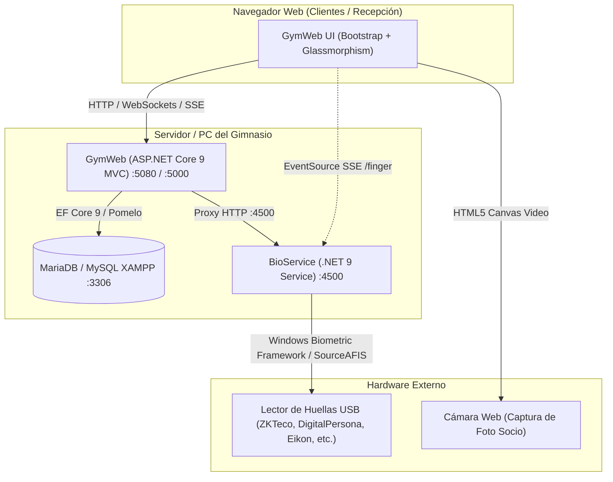

# 🏋️ Estado Actual, Estructura y Registro de Cambios — Sistema de Gestión para Gimnasio

**Autor:** Ing. Victor Hernández  
**Canal de YouTube:** [@SoluciónDigital360](https://www.youtube.com/@SoluciónDigital360)  
**Tecnología Base:** ASP.NET Core 9 MVC + .NET 9 + MariaDB / MySQL (XAMPP)  
**Licencia:** Apache License 2.0  
**Última Actualización:** Agosto 2026  

---

## 📌 1. Resumen Ejecutivo del Proyecto

El sistema es una plataforma integral para la administración comercial, control de acceso biométrico, membresías, inventario y reportes financieros de gimnasios. Cuenta con una arquitectura desacoplada y modular:



---

## 🏛️ 2. Estructura Completa del Repositorio

```
Gym/
├── Gym.sln                                  # Solución Visual Studio (.NET 9)
├── README.md                                # Ficha técnica general
├── ESTRUCTURA_Y_CAMBIOS.md                  # Manual de arquitectura, cambios y mantenimiento
├── PUBLICAR.bat                             # Generador de instaladores completos (Win / Mac)
├── GENERAR-PARCHE.bat                       # Launcher para empaquetar parches de actualización
├── generar_parche.ps1                       # Script PowerShell generador del parche incremental
├── License.txt                              # Licencia Apache 2.0
├── NOTICE                                   # Créditos y autoría
│
├── BD/                                      # 🗄️ Esquema y Scripts de Migración SQL
│   ├── gym.sql                              # Esquema base completo con datos iniciales
│   ├── gym_export.sql                       # Respaldo completo de la base de datos
│   ├── migracion_periodos_dias.sql          # Migración para soporte de duración en días
│   ├── fix_registro_socios_eliminados.sql   # Integridad referencial de visitas
│   └── migracion_template_biometrico.sql    # Campo template LONGBLOB en tabla socio_huella
│
├── GymWeb/                                  # 🌐 Aplicación Web Principal (ASP.NET Core 9 MVC)
│   ├── Program.cs                           # Startup, DI, DbContext, auto-migraciones y sesiones
│   ├── GymWeb.csproj                        # Configuración .NET 9 y paquetes NuGet
│   ├── appsettings.json                     # Conexión MySQL y configuración general
│   ├── appsettings.Development.json         # Configuración para entorno de desarrollo
│   ├── appsettings.Production.json          # Configuración para producción (puerto 5080)
│   ├── Controllers/                         # 14 Controladores MVC
│   │   ├── AuthController.cs                # Base con filtro de sesión activa
│   │   ├── SuperAdminController.cs          # Base con filtro para rol 'superadmin'
│   │   ├── AccountController.cs             # Login, Logout y auto-migración MD5 -> BCrypt
│   │   ├── HomeController.cs                # Dashboard principal con métricas y alertas
│   │   ├── SociosController.cs              # CRUD socios, webcam en vivo y membresía inline
│   │   ├── MembresiasController.cs          # Catálogo de membresías y vigencias
│   │   ├── PagosController.cs               # Registro de pagos, métodos y exportación CSV
│   │   ├── ProductosController.cs           # Inventario, stock mínimo y venta rápida POS
│   │   ├── RegistroController.cs            # Check-in de socios y cobro de visitas de día
│   │   ├── ReportesController.cs            # Cortes de caja diario/mensual, asistencias y CSV
│   │   ├── BiometricoController.cs          # Proxy HTTP hacia BioService (:4500)
│   │   ├── UsuariosController.cs            # Gestión de cuentas y roles de administradores
│   │   ├── ConfiguracionController.cs       # Personalización visual, logo y recordatorios
│   │   └── BackupController.cs              # Generación de respaldos .sql y limpieza de BD
│   ├── Models/                              # 22 Modelos EF Core y Vistas SQL
│   │   ├── GymContext.cs                    # DbContext principal de EF Core
│   │   ├── Socio.cs, Membresium.cs, ...     # Modelos de tablas de negocio
│   │   ├── SocioHuella.cs                   # Modelo biométrico (PIN + Template BLOB)
│   │   └── Vwsocio.cs, Vwusuario.cs, ...    # Modelos mapeados a Vistas SQL
│   ├── Views/                               # Vistas Razor con diseño Glassmorphism
│   ├── Helpers/                             # Clases auxiliares y AppSettings globales
│   └── wwwroot/                             # Assets estáticos (CSS, JS, fotos de socios)
│
├── BioService/                              # 👆 Microservicio Biométrico Universal (.NET 9)
│   ├── Program.cs                           # API REST, SSE (/finger), WinBio y SourceAFIS
│   ├── BioService.csproj                    # Proyecto .NET 9 con soporte Windows Service
│   ├── Backends/
│   │   ├── BackendSelector.cs               # Auto-detección del mejor backend disponible
│   │   ├── IFingerBackend.cs                # Interfaz abstracta para backends de captura
│   │   ├── WinBioBackend.cs                 # Conexión nativa con Windows Biometric Framework
│   │   ├── PinOnlyBackend.cs                # Fallback por PIN / Teclado numérico / Barcode
│   │   └── SourceAfisHelper.cs              # Algoritmo matemático de matching 1:1 y 1:N
│   ├── Tests/
│   │   └── DiagnosticTest.cs                # Suite de 7 pruebas sintéticas unitarias de huellas
│   ├── INICIAR-BioService.bat               # Launcher interactivo del servicio en puerto 4500
│   └── PROBAR-DIAGNOSTICO.bat               # Launcher para ejecutar la suite de diagnóstico
│
├── Publish/                                 # 🚀 Scripts de Despliegue e Instalación
│   ├── INSTALAR.bat                         # Instalador desatendido para Windows (Crea servicios)
│   ├── INSTALAR.command                     # Instalador para macOS
│   ├── ACTUALIZAR.bat                       # Launcher para aplicar parches en clientes
│   ├── actualizar.ps1                       # Lógica robusta de actualización sin pérdidas de datos
│   └── Iniciar GymWeb.bat                   # Acceso directo para levantar GymWeb
│
├── dist/                                    # 📦 Salidas Compiladas y Distribución
│   ├── GymWeb-Windows/                      # Paquete autocontenido listo para Windows x64
│   ├── GymWeb-Mac-AppleSilicon/             # Paquete autocontenido para Mac M1/M2/M3/M4
│   ├── Actualizacion-GymWeb/                # Archivos preparados para el parche
│   └── Parche_GymWeb_v2.0.zip               # ZIP final del parche incremental para clientes
│
├── zk9500-service/                          # 🟡 (Obsoleto) Anterior servicio Node.js
└── Gimnasio/                                # ⚪ (Legacy) Proyecto de escritorio WinForms
```

---

## 🔄 3. Registro Histórico de Versiones y Cambios

### 🔹 Versión 1.0 — Sistema Legacy de Escritorio
- Base de datos MySQL `gym` original.
- Aplicación de escritorio C# Windows Forms (.NET Framework 4.0).
- Lógica base de socios, membresías, productos y cobros directos.

### 🔹 Versión 1.5 — Migración Web (`GymWeb`)
- Reescritura completa en **ASP.NET Core 9 MVC** y **Entity Framework Core 9**.
- Diseño moderno Glassmorphism con tarjetas traslúcidas, gradientes y animaciones.
- Seguridad reforzada:
  - Manejo de sesiones seguras (`AuthController`).
  - Hashing de contraseñas con **BCrypt** (`BCrypt.Net-Next`) y migración transparente de hashes MD5 heredados.
  - Protección de vistas y rutas administrativas con `SuperAdminController`.

### 🔹 Versión 1.8 — Módulos Operativos y Reportes
- **Socios:** Captura de fotos en tiempo real con webcam (HTML5 Canvas Base64) o subida local.
- **Membresías:** Soporte flexible de vigencia en meses o días (`migracion_periodos_dias.sql`).
- **Punto de Venta e Inventario:** Control de stock con alertas mínimas, venta rápida y reabastecimiento AJAX.
- **Registro de Visitas:** Check-in ágil para socios y visitas de día para no socios con precio configurable.
- **Cortes y Reportes:** Generación de corte diario/mensual integrando membresías, productos y visitas, con exportación a CSV.
- **Respaldos:** Módulo de backups `.sql` mediante `mysqldump` y limpieza controlada de base de datos.

### 🔹 Versión 2.0 — Servicio Biométrico Universal (`BioService`)
- **Problema resuelto:** El servicio previo `zk9500-service` (Node.js) dependía de drivers específicos no portables y forzaba el modo de simulación en hardware real.
- **Nuevo `BioService` (.NET 9):**
  - Conexión universal mediante **Windows Biometric Framework (WBF)** para lectores USB (ZKTeco ZK9500/ZK4500, DigitalPersona U.are.U 4500/5100, Eikon, y sensores de huella integrados en laptops).
  - Algoritmo matemático **SourceAFIS** para extracción de vectores biométricos y matching 1:1 y 1:N.
  - Compatibilidad total con la API REST de `GymWeb` (`/status`, `/devices`, `/capture`, `/verify`, `/finger` vía Server-Sent Events).
  - Script de migración `BD/migracion_template_biometrico.sql` y auto-migración en `Program.cs`.
  - Suite de diagnóstico automatizada con 7 pruebas unitarias sintéticas ([PROBAR-DIAGNOSTICO.bat](file:///c:/xampp/htdocs/Gym%20(2)/Gym/BioService/PROBAR-DIAGNOSTICO.bat)).

### 🔹 Versión 2.0.1 — Corrección y Automatización del Parche de Actualización
- **Corrección de cierre prematuro:** Se resolvió el error de sintaxis en `cmd.exe` (`No se esperaba | en este momento`) separando la lógica del actualizador en [actualizar.ps1](file:///c:/xampp/htdocs/Gym%20(2)/Gym/Publish/actualizar.ps1) y [ACTUALIZAR.bat](file:///c:/xampp/htdocs/Gym%20(2)/Gym/Publish/ACTUALIZAR.bat).
- **Auto-registro como Servicio de Windows:** `BioService` ahora se instala y arranca automáticamente como Servicio de Windows en segundo plano, evitando que los administradores tengan que mantener una consola abierta.
- **Protección de Datos:** La actualización preserva 100% las configuraciones, credenciales de base de datos y socios registrados en los clientes.
- **Instalador Fresh:** Se actualizó [INSTALAR.bat](file:///c:/xampp/htdocs/Gym%20(2)/Gym/Publish/INSTALAR.bat) para que las instalaciones nuevas configuren ambos servicios (`GymWeb` y `BioService`) desde el inicio.

### 🌟 Versión 2.1.0 — Modo Autónomo SQLite y Ventana de Escritorio Nativa (App Mode)
- **Soporte Dual Inteligente (MySQL + SQLite):**
  - Detección dinámica de motor en `Program.cs`: clientes con MySQL de XAMPP continúan sin cambios ni riesgo de desconexión; clientes nuevos o migrados trabajan con base de datos local `gym.db`.
  - Corrección de llaves primarias en `GymContext.cs` eliminando `int(11)` para compatibilidad estricta con `INTEGER PRIMARY KEY AUTOINCREMENT` de SQLite.
- **Motor de Migración de Datos Zero-Loss (`MySqlToSqliteMigrator.cs`):**
  - Migración tabla por tabla de 13 entidades (socios con fotos en BLOB, templates biométricos, pagos, visitas, inventario y ventas) en transacciones atómicas seguras.
  - Sincronización automática de secuencias en `sqlite_sequence` para preservar el orden consecutivo de IDs.
  - Disponible tanto desde la Web (`/Backup`) como por CLI / batch (`MIGRAR-DATOS-MYSQL-A-SQLITE.bat`).
- **Paleta de Colores Dinámica (6 Temas Corporativos):**
  - Implementación de 6 esquemas de color: Cian Neón (`cyan`), Esmeralda (`emerald`), Naranja Fuego (`orange`), Púrpura Eléctrico (`purple`), Rojo Pasión (`red`) y Oro Deportivo (`gold`).
  - Selector visual interactivo en la barra superior (`topbar`) con icono de paleta, en la pantalla de Configuración y en el Login.
  - Almacenamiento persistente en `localStorage` con script anti-flicker en el `<head>` para cambio instantáneo sin parpadeos.
- **Modo Aplicación de Escritorio (App Window Nativo - Estilo Electron sin peso extra):**
  - Lanzador inteligente `Iniciar Gym.bat` y lanzador 100% silencioso `AbrirGym.vbs`.
  - Ejecución en ventana nativa aislada mediante Microsoft Edge / Chrome (`--app=http://localhost:5080`) sin barras de URL, pestañas ni botones del navegador.
  - Script `Crear Acceso Directo.bat` para anclar el icono oficial en el Escritorio del usuario con un solo clic.

---

## 📊 4. Estado Actual de Componentes

| Componente | Estado | Versión / Puerto | Función Principal |
|------------|:---:|------------------|-------------------|
| **`GymWeb`** | 🟢 **Operativo** | ASP.NET Core 9 (Puerto 5080 prod / 5000 dev) | Frontend MVC, control de socios, cobros, inventario y reportes. |
| **`BioService`** | 🟢 **Operativo** | .NET 9 (Puerto 4500) | Microservicio biométrico con WBF, SourceAFIS y eventos SSE. |
| **Base de Datos** | 🟢 **Estable** | MariaDB 10.4+ / MySQL | 12 tablas, 8 vistas SQL y auto-migraciones activas. |
| **Instalador Completo** | 🟢 **Listo** | Multiplataforma (`dist/GymWeb-Windows`) | Para instalaciones nuevas desde cero. |
| **Parche de Actualización** | 🟢 **Listo** | v2.0.1 (`dist/Parche_GymWeb_v2.0.zip`) | Para actualizar clientes en producción sin alterar su BD. |
| **`zk9500-service`** | 🟡 **Obsoleto** | Node.js | Reemplazado por `BioService`. |
| **`Gimnasio`** | ⚪ **Legacy** | .NET Framework 4.0 WinForms | Mantenido como referencia histórica. |

---

## 🛠️ 5. Guía para Futuras Modificaciones y Mantenimiento

### 🔨 A. Cómo Compilar y Publicar una Versión Completa Nueva
Para generar los instaladores completos para nuevas computadoras o clientes:
1. Ejecutar el archivo:
   ```cmd
   PUBLICAR.bat
   ```
2. El script compilará `GymWeb` y `BioService` en modo *self-contained* y generará las carpetas:
   - `dist/GymWeb-Windows/` (Listo para copiar y ejecutar `INSTALAR.bat` como Administrador).
   - `dist/GymWeb-Mac-AppleSilicon/` (Para macOS ARM64).
   - `dist/GymWeb-Mac-Intel/` (Para macOS Intel).

### 📦 B. Cómo Generar un Nuevo Parche para Clientes en Producción
Si realizas cambios en el código de `GymWeb` o `BioService` y necesitas enviar una actualización a gimnasios existentes:
1. Ejecutar el archivo:
   ```cmd
   GENERAR-PARCHE.bat
   ```
2. El script compilará los cambios y creará el archivo comprimido:
   - `dist/Parche_GymWeb_v2.0.zip`
3. Enviar dicho `.zip` al cliente. El cliente solo debe descomprimirlo y hacer clic derecho en `ACTUALIZAR.bat` ➔ *Ejecutar como administrador*.

### 🧪 C. Cómo Probar el Motor Biométrico sin un Lector Físico
Para verificar que el algoritmo de extracción y emparejamiento de huellas funciona correctamente en cualquier equipo:
1. Abrir una consola en `Gym/BioService` o hacer doble clic en:
   ```cmd
   BioService/PROBAR-DIAGNOSTICO.bat
   ```
2. El sistema ejecutará las 7 pruebas unitarias automáticas (generación sintética, extracción de minutiae, matching idéntico, rechazo de impostores, serialización y velocidad 1:N).

### 🗄️ D. Reglas para Modificaciones de Base de Datos
- **Nunca sobrescribir bases de datos en producción:** Al agregar nuevas columnas o tablas, crear siempre un script SQL de migración en la carpeta `BD/` con la cláusula `IF NOT EXISTS` o `ADD COLUMN IF NOT EXISTS`.
- **Auto-migraciones en `Program.cs`:** Si una columna es crítica para una nueva funcionalidad, agregar la sentencia de verificación en el bloque `try/catch` de auto-migración en `GymWeb/Program.cs`.

---

## 🖐️ Soporte Universal de Lectores de Huella (Detección Hot-Plug y Auto-Diagnóstico)

Se resolvió la incompatibilidad con diferentes lectores USB del mercado mediante una arquitectura abierta y auto-diagnóstica:

1. **Detección Dinámica en Caliente (`DynamicBackendSelector.cs`):**
   - El servicio ya no queda bloqueado en modo estático al arrancar. Si el cliente conecta o desconecta el lector USB mientras el sistema está abierto, se detecta y activa automáticamente.
2. **Escáner de Hardware PnP en Tiempo Real (`HardwareDetector.cs`):**
   - Analiza dispositivos USB y controladores WBF mediante WMI (`Win32_PnPEntity`). Identifica de inmediato familias DigitalPersona, ZKTeco, SecuGen y Windows Hello.
3. **Endpoint de Diagnóstico y Semáforo UI en GymWeb:**
   - En el modal de registro de huella de `Socios/Index.cshtml`, una barra de estado informa con semáforo (Verde, Amarillo, Gris) si el lector está listo o qué driver específico requiere.
4. **Corrección de Seguridad en Captura:**
   - Se integró el token antifalsificación CSRF (`FormData` con `__RequestVerificationToken`) en la llamada asíncrona de captura.
5. **Herramientas de Soporte Incluidas:**
   - [`PROBAR-LECTOR-USB.bat`](file:///c:/xampp/htdocs/Gym%20(2)%20-%20copia/Gym/PROBAR-LECTOR-USB.bat): Script de 1 clic para diagnóstico rápido de puertos USB y BioService.
   - [`GUIA_LECTORES_HUELLA.md`](file:///c:/xampp/htdocs/Gym%20(2)%20-%20copia/Gym/GUIA_LECTORES_HUELLA.md): Manual para soporte a clientes con las 3 opciones de lectores más populares del mercado.
6. **Validación de Persistencia y Limpieza:**
   - Flujo de captura y guardado de templates biométricos validado exitosamente en base de datos (`socio_huella`). El botón y endpoints de simulación temporal fueron removidos para dejar la interfaz 100% limpia y lista para producción.

---

## 🛒 Tienda POS E-Commerce (Módulo de Ventas Rediseñado v2.2)

Se transformó por completo el módulo administrativo tradicional de "Ventas" en una experiencia moderna tipo **E-COMMERCE + PUNTO DE VENTA (POS)** inspirada en aplicaciones fitness profesionales:

1. **Encabezado y Barra de Búsqueda:**
   - Título `🏋️ Tienda` con subtítulo `Productos y ventas del gimnasio`.
   - Buscador inteligente reactivo por nombre y categoría con atajo rápido de teclado `Ctrl + K`.
   - Indicador superior de carrito con contador de artículos y monto en tiempo real.
2. **4 Tarjetas de Resumen del Día (Métricas en Tiempo Real):**
   - **Ventas de hoy:** Total de transacciones completadas durante el día.
   - **Ingresos de hoy:** Monto total monetario recaudado en el día (en verde positivo).
   - **Productos vendidos:** Unidades físicas totales despachadas hoy.
   - **Stock bajo:** Alerta con la cantidad de productos con existencias por debajo del mínimo configurado.
3. **Filtros por Categoría:**
   - Selector en pastillas redondeadas con iconos: `Todos`, `Suplementos`, `Ropa`, `Equipo`, `Bebidas`, `Accesorios`, `Otros`, `Stock bajo` y switch `Solo con stock`.
4. **Catálogo de Productos E-Commerce:**
   - Tarjetas con iluminación neon y bordes redondeados.
   - Badges automáticos: `⚡ Más vendido`, `⚠️ Stock bajo`, `Agotado`.
   - SVGs vectoriales integrados en alta resolución según la categoría para productos sin fotografía.
   - Indicador visual de stock disponible y botón cyan `[ 🛒 Agregar al carrito ]`.
5. **Panel Lateral del Carrito POS:**
   - Carrito fijo/sticky en escritorio y drawer táctil en móvil.
   - Selector de cantidades reactivo `[ - 1 + ]` con validación de inventario máximo en tiempo real.
   - Botón de eliminación rápida y botón `Limpiar`.
   - Campo para aplicar descuentos opcionales y cálculo automático del total general.
   - Botón destacado `[ 💳 Cobrar venta ➔ ]`.
6. **Modal de Checkout y Cobro:**
   - Tres métodos de pago admitidos:
     - 💵 **Efectivo:** Calculadora de cambio en tiempo real con botones rápidos de billetes comunes ($50, $100, $200, $500, $1,000, Exacto) y bloqueo de confirmación si el importe es insuficiente.
     - 🏦 **Transferencia:** Registro de referencia/folio de operación y banco.
     - 💳 **Tarjeta:** Cobro con terminal física con captura de referencia/autorización.
   - Transacción atómica en base de datos (`Serializable`) que valida stock, crea la cabecera `salida`, partidas `detallesalida`, descuenta inventario y asigna folio correlativo (#000125).
7. **Confirmación y Detalle de Venta:**
   - Modal tipo ticket POS con check animado, folio, desglose y botones para "Nueva venta" o "Ver en historial".
   - Historial de ventas modernizado con tabla responsiva, badges por método de pago y modal con desglose completo de partidas.
8. **Integridad de Datos:**
   - Base de datos intacta (cero DROP TABLE); auto-migración segura con `ALTER TABLE salida ADD COLUMN ...` para almacenar método de pago, folio y cambio sin alterar ventas pasadas ni el producto `"Agua Ciel 1Lt"`.

---

## 🚀 Actualización Mayor v2.1 / v2.2: Modo Autónomo (SQLite), Visor Nativo y Licencias

### 1. Base de Datos Híbrida y Modo 100% Autónomo (SQLite `gym.db`):
* **Independencia de XAMPP:** El sistema ya no exige MySQL ni XAMPP para operar. Admite el motor local ultrarrápido SQLite empaquetado en el archivo `gym.db`.
* **Compatibilidad Dual Inteligente (`Program.cs`):** Al iniciar, el sistema analiza la cadena de conexión configurada en `appsettings.json`:
  * Si contiene `Server=` o `Database=`, activa el proveedor MySQL/MariaDB conectando a XAMPP sin alterar datos previos.
  * Si contiene `Data Source=`, activa SQLite en modo nativo con journaling WAL de alto rendimiento.
* **Migrador Seguro de MySQL a SQLite ([`MIGRAR-DATOS-MYSQL-A-SQLITE.bat`](file:///c:/xampp/htdocs/Gym%20(2)%20-%20copia/Gym/Publish/MIGRAR-DATOS-MYSQL-A-SQLITE.bat)):**
  * Herramienta con interfaz gráfica de consola que lee todas las tablas de MySQL mediante sentencias `SELECT` de solo lectura.
  * **Cero riesgo de pérdida:** En ningún momento ejecuta `DROP`, `DELETE` o `TRUNCATE` en MySQL. La base de XAMPP queda intacta como respaldo inmutable.
  * Copia 100% de datos binarios (fotos de socios en BLOB, huellas biométricas), cobros, catálogo, ventas y usuarios.
  * Sincroniza secuencias autoincrementales y actualiza automáticamente `appsettings.json` y `appsettings.Production.json` para pasar a SQLite en un solo clic.
* **Resolución Absoluta de Directorios (`AppContext.BaseDirectory`):**
  * Se blindó `Program.cs` con `Directory.SetCurrentDirectory(AppContext.BaseDirectory)` para evitar que servicios de Windows busquen la base de datos o logs en `C:\Windows\System32`.

### 2. Visor Nativo de Escritorio Autónomo y Auto-Reparable ([`Gym.exe`](file:///c:/xampp/htdocs/Gym%20(2)%20-%20copia/Gym/GymApp/Form1.cs)):
* **Compilación 100% Autocontenida (Self-Contained x64):**
  * `GymApp` incorpora las librerías de Windows Forms y Desktop Runtime. No solicita al cliente descargar `.NET Desktop Runtime 9.0`.
* **Auto-Detección y Levantamiento en Segundo Plano:**
  * Si el usuario abre el acceso directo y el backend `GymWeb.exe` o `BioService.exe` no están corriendo (porque no se instaló el servicio de Windows o la máquina se reinició), `Gym.exe` **los inicia automáticamente de forma invisible**.
* **Pantalla de Carga Oscura (Cero Errores `ERR_CONNECTION_REFUSED`):**
  * Mientras el servidor local e inicialización de SQLite arrancan, muestra una pantalla de bienvenida oscura (`#0f141c`) con branding en cian: *"Iniciando Sistema del Gimnasio..."*.
  * Monitorea la conexión en el puerto `5080` (con fallback a `5250`) y solo despliega la vista una vez que el servidor responde HTTP 200/302.
  * Incluye reintento automático y botón de reconexión manual.
* **Unificación de Puertos:** Puerto oficial estandarizado en `5080` en toda la solución (`appsettings.json`, `appsettings.Production.json`, `INSTALAR.bat` y `Form1.cs`).

### 3. Sistema de Licenciamiento y Período de Prueba:
* **Seguridad por Hardware (`PC ID`):**
  * El sistema calcula un identificador criptográfico único atado a la placa base, CPU y RAM del equipo del cliente.
* **Bloqueo Inteligente tras 7 días:**
  * Pasados los 7 días de demo, el middleware restringe el acceso a las funciones operativas y redirige amigablemente a la pantalla de Activación de Licencia.
  * En dicha pantalla, el cliente puede consultar su PC ID y presionar el botón directo de WhatsApp hacia el administrador (`529611209361`).
* **Generador Externo ([`generador-licencias-gym.html`](file:///c:/xampp/htdocs/Gym%20(2)%20-%20copia/Gym/generador-licencias-gym.html)):**
  * Herramienta web cliente para generar claves de prueba (`GYM7-...`) o vitalicias (`GYM-...`).
* **Preservación Total de Datos en Producción:**
  * Al ingresar la licencia vitalicia, todos los socios, fotos, cobros y configuraciones capturados en los días de prueba permanecen 100% intactos.

---

## 📋 Reglas Estrictas para Generación de Parches e Instaladores (Guía para Agentes y Desarrolladores)

Todo agente o desarrollador que trabaje en este proyecto **DEBE RESPETAR ESTRICTAMENTE** las siguientes directrices para evitar pérdida de datos o enviar archivos innecesarios a clientes:

### 🛡️ REGLAS DE ORO DE PROTECCIÓN DE DATOS DEL CLIENTE:
1. **JAMÁS incluir `gym.db` en un Parche ni en el Instalador limpio:**
   * En el **Instalador nuevo**, la base debe crearse virgen en el primer arranque.
   * En un **Parche**, si se sobreescribe `gym.db`, se destruirían los socios y cobros reales del gimnasio.
2. **JAMÁS sobreescribir `appsettings.json` ni `appsettings.Production.json` en un Parche:**
   * Cada cliente tiene su propia configuración (cadena de conexión MySQL o SQLite, credenciales y puerto). El parche debe preservar estos archivos intactos.
3. **JAMÁS incluir `wwwroot/img/socios/` ni `logo-custom.png` en un Parche:**
   * Estos directorios contienen las fotos de los socios del gimnasio y el logo del negocio.
4. **Garantizar que MySQL permanezca intacto:**
   * Los scripts de actualización o migración nunca deben ejecutar `DROP DATABASE`, `DROP TABLE` ni `DELETE` en MySQL. La migración a SQLite es opcional y solo realiza `SELECT`.

---

### 📦 TIPOS DE PARCHES Y CÓMO GENERARLOS:

#### Tipo A: Micro-Parche Ligero de Código / Vistas (~2 MB) — *El más común*
* **¿Cuándo usarlo?** Cuando solo se modifica código en C# (controladores, modelos, servicios), vistas Razor (`.cshtml`), o reportes.
* **Principio Técnico:** En ASP.NET Core (.NET 9), **todas las vistas Razor, controladores y modelos se compilan dentro de un solo archivo binario: `GymWeb.dll`**.
* **Archivos que componen el Micro-Parche:**
  ```
  📁 Parche_Ligero_vX.X/
     ├── GymWeb.dll          (~1.8 MB - Todo el sistema compilado)
     ├── ACTUALIZAR.bat      (Detiene GymWeb, reemplaza el DLL y reinicia el servicio)
     └── wwwroot/            (OPCIONAL: Solo si se cambiaron archivos CSS/JS/imágenes estáticas)
  ```
* **Herramienta:** Ejecutar [`GENERAR-PARCHE-LIGERO.bat`](file:///c:/xampp/htdocs/Gym%20(2)%20-%20copia/Gym/GENERAR-PARCHE-LIGERO.bat). Genera `dist/Parche_Ligero_GymWeb.zip` listo para mandar por WhatsApp en 2 segundos.

#### Tipo B: Parche Mayor de Arquitectura (~150 MB)
* **¿Cuándo usarlo?** Solo cuando se actualizan componentes pesados del sistema operativo:
  * Modificaciones al visor de escritorio `Gym.exe` (WebView2, Forms autocontenido).
  * Nuevas versiones del microservicio `BioService.exe` o drivers de huella.
  * Nuevos scripts de instalación de servicios de Windows.
* **Herramienta:** Ejecutar [`GENERAR-PARCHE.bat`](file:///c:/xampp/htdocs/Gym%20(2)%20-%20copia/Gym/GENERAR-PARCHE.bat) o `generar_parche.ps1`. Genera `dist/Parche_GymWeb_v2.1.zip`.

#### Tipo C: Instalador Completo para Clientes Nuevos (~129 MB)
* **¿Cuándo usarlo?** Para entregar el sistema a un cliente nuevo que lo instalará desde cero.
* **Características obligatorias:**
  * 100% Autocontenido x64 (no requiere instalar .NET, XAMPP ni MySQL).
  * Sin archivo `license.json` (inicia en modo de prueba de 7 días y muestra el PC ID).
  * Sin archivo `gym.db` (autogenera base virgen de 0 socios).
  * Sin logos ni fotos de prueba.
* **Herramienta:** Ejecutar `generar_instalador.ps1`. Genera `dist/Instalador_GymWeb_Windows_v2.1.zip`.

---

## 🔄 ACTUALIZACIÓN v2.2 — SISTEMA AUTÓNOMO DE NOTIFICACIONES, PARCHES Y DESPLIEGUE

### 1. Arquitectura de Actualizaciones Vía GitHub Releases API
Para evitar tener que enviar manualmente archivos o enlaces a cada gimnasio cuando se corrigen errores o se agregan funciones, se implementó un sistema de actualización cliente-servidor descentralizado utilizando la **API pública de GitHub Releases**:

* **Endpoint Backend:** `GET /Home/CheckUpdate` en `HomeController.cs`.
  * Consulta: `https://api.github.com/repos/victorhernandez-art/sistema-gimnasio/releases/latest`.
  * Header obligatorio: `User-Agent: GymWeb-UpdateChecker/2.1` (requerido por GitHub para autorizar peticiones).
  * Parámetros extraídos del Release de GitHub:
    * `tag_name`: Identificador de la última versión (ej: `v2.2`).
    * `name`: Título del release publicado.
    * `body`: Notas de la versión escritas por el desarrollador en GitHub (lo que incluye la actualización).
    * `assets`: Busca automáticamente cualquier asset cuyo nombre contenga `"Parche"` o `"Instalador"` y extrae su `browser_download_url` directo.
  * **Caché en Memoria (24 horas):** `_cachedLatestVersion`, `_cachedDownloadUrl`, `_cachedReleaseNotes`, `_cachedReleaseTitle` y `_cacheExpiry`. Protege contra el rate limit de GitHub (60 peticiones/hora por IP) evitando consultas en cada recarga de página.
  * **Comparación de Versiones:** Compara `latestTag` contra `AppSettings.CurrentVersion`. Si son distintos, devuelve `hasUpdate: true`.
  * **Blindaje por Fallo:** Si no hay internet o la API de GitHub no responde, retorna `{ hasUpdate: false }` silenciosamente sin romper el sistema.

---

### 2. Modal Interactivo de Actualización en Pantalla (`_Layout.cshtml`)
En lugar de un toast pequeño o avisos intrusivos, se diseñó un **modal centrado con estética glassmorphism premium**:
* **Ubicación:** `GymWeb/Views/Shared/_Layout.cshtml`.
* **Condición de Renderizado:** `@if (Context.Session.GetString("UsuarioRol") == "superadmin" && GymWeb.Helpers.LicenseService.GetStatus().Valid)`. Solo se muestra al Administrador/Super Administrador y **únicamente si el sistema ya cuenta con licencia válida o prueba activa** (no confunde a clientes nuevos que aún no activan su clave).
* **Elementos del Modal:**
  1. **Encabezado:** Badge de versión con gradiente cian (`Versión actual: v2.1 ➔ Nueva versión: v2.2`).
  2. **Notas del Parche Dinámicas:** Contenedor `#upNotesSection` que renderiza automáticamente el texto `body` del release de GitHub en la sección *"¿Qué incluye esta actualización?"*.
  3. **Instrucciones Paso a Paso:** 4 pasos numerados con iconos claros que guían al cliente para descomprimir el archivo en su carpeta de instalación y ejecutar `ACTUALIZAR.bat` como administrador.
  4. **Aviso de Seguridad:** Mensaje en verde confirmando que los socios, cobros y configuración **no se borran**.
  5. **Botones de Acción:**
     * `Descargar parche`: Descarga directamente el ZIP (`Parche_Ligero_GymWeb.zip`) desde GitHub Releases.
     * `Más tarde`: Cierra el modal y activa una posposición de 24 horas.

---

### 3. Ciclo de Vida de Almacenamiento y Sesión (WebView2 y Navegadores)
La aplicación de escritorio (`Gym.exe`) utiliza el motor **WebView2** de Microsoft Edge, el cual almacena datos en `%LOCALAPPDATA%\GymAppCache`. Para evitar que el modal se bloquee o moleste en cada navegación:

* **Posposición ("Más tarde" o cierre):** Al hacer clic en *"Más tarde"* o en la `X`, se guardan dos claves en `localStorage`:
  * `gym_update_dismissed`: La versión descartada (ej: `v2.2`).
  * `gym_update_dismissed_exp`: Fecha/hora de expiración en formato ISO (+24 horas).
* **Limpieza Automática:** Al cargar `_Layout.cshtml`, si no existe fecha de expiración válida (`!exp || isNaN(Date.parse(exp))`) o si la fecha ya venció (`new Date() > new Date(exp)`), las marcas de descarte se eliminan automáticamente.
* **Control de Sesión:** Para evitar que el modal se vuelva a disparar al navegar entre pestañas (Socios, Membresías, Cobros), se utiliza `sessionStorage`:
  * Solo se marca `sessionStorage.setItem('gym_update_checked', 'shown')` **después** de que el modal se dibuja exitosamente en pantalla.
  * Si el modal nunca se mostró (ej. fallo temporal o navegación rápida), no se bloquea.

---

### 4. Indicador de Versión en el Sidebar
Para que tanto el usuario como el soporte técnico puedan validar en todo momento la versión instalada:
* Ubicado en `_Layout.cshtml` dentro de `.sidebar-footer`, inmediatamente debajo del botón *"Cerrar Sesión"*.
* Renderiza: `Versión @GymWeb.Helpers.AppSettings.CurrentVersion`.
* Estilos en `wwwroot/css/gym.css` (`.sidebar-version`): Tipografía monospace sutil, color muted y centrado.
* Al colapsar la barra lateral (`.sidebar.collapsed`), el texto se oculta automáticamente para preservar la armonía visual.

---

### 5. Estética Corporativa Limpia (Eliminación de Iconos/Emojis "Estilo IA")
Se realizó una depuración visual completa para eliminar elementos que dieran impresión de "plantilla generada por IA":
* **Varita mágica (`fa-wand-magic-sparkles`):** Eliminada del banner de bienvenida y del selector de colores. En el selector de temas se reemplazó por una paleta formal (`fa-palette`).
* **Emojis informales (`👋`, `🎉`, etc.):** Removidos de los avisos y banners de bienvenida.
* **Cajas de Cohetes gigantes (`fa-rocket`):** Eliminadas de la tarjeta de activación de prueba; los botones de activación ahora utilizan el icono corporativo de confirmación (`fa-circle-check`).
* **Dashboard:** En el aviso de prueba activa se sustituyeron los destellos (`sparkles`) por un escudo de seguridad sobrio (`fa-shield-halved`) y redacción empresarial.

---

### 6. Mecánica de Trabajo, Repositorio GitHub y Vercel

```
[ PÁGINA WEB EN VERCEL ]
       │
       ▼ (Botón: Descargar Instalador)
[ REPO GITHUB: Releases ]
  ├── Tag v2.1 ─── Asset: Instalador_GymWeb_Windows_v2.1.zip  (~129 MB, Instalador Completo)
  │                * URL fija para el botón de Vercel.
  │                * Por dentro ya contiene la versión v2.2 precompilada.
  │
  └── Tag v2.2 ─── Asset: Parche_Ligero_GymWeb.zip           (~9.88 MB, Micro-Parche)
                   * Contiene GymWeb.dll + ACTUALIZAR.bat + wwwroot.
                   * Lo descarga automáticamente el cliente existente desde el Modal.
```

#### Regla de Oro con el botón de Vercel:
El botón de descarga en tu landing page de Vercel tiene configurada una URL directa que apunta al release `v2.1`:
`https://github.com/victorhernandez-art/sistema-gimnasio/releases/download/v2.1/Instalador_GymWeb_Windows_v2.1.zip`

* **NUNCA cambiar el nombre del archivo ni el tag en GitHub para clientes nuevos.**
* Si generas un instalador nuevo, **se debe conservar el nombre `Instalador_GymWeb_Windows_v2.1.zip`**.
* Al subirlo con ese mismo nombre al release `v2.1`, reemplaza el ZIP anterior y **tu página en Vercel seguirá funcionando de inmediato sin tener que modificar ni redesplegar nada en Vercel**.

---

### 7. Guía Paso a Paso para Desarrolladores / Agentes (Futuras Versiones v2.3, v2.4, etc.)

Cuando se hagan nuevas mejoras o correcciones en el sistema:

1. **Modificar Código:** Realizar los cambios correspondientes en controladores, vistas o estilos.
2. **Actualizar Número de Versión:** En [`GymWeb/Helpers/AppSettings.cs`](file:///c:/xampp/htdocs/Gym%20(2)%20-%20copia/Gym/GymWeb/Helpers/AppSettings.cs):
   ```csharp
   public const string CurrentVersion = "v2.3"; // Incrementar aquí
   ```
3. **Generar el Parche Ligero:**
   * Ejecutar [`GENERAR-PARCHE-LIGERO.bat`](file:///c:/xampp/htdocs/Gym%20(2)%20-%20copia/Gym/GENERAR-PARCHE-LIGERO.bat) (o `powershell -File generar_parche_ligero.ps1`).
   * Produce: `dist/Parche_Ligero_GymWeb.zip` (~9.88 MB).
4. **Publicar en GitHub:**
   * Crear un nuevo Release en GitHub con el Tag `v2.3` (ej. *"Sistema para Gimnasios v2.3"*).
   * En las notas de la versión (descripción del release), redactar en viñetas lo que incluye (ej: `✅ Nuevo módulo X`, `✅ Corrección de Y`). **Este texto aparecerá textualmente dentro del modal del cliente**.
   * Adjuntar el archivo `dist/Parche_Ligero_GymWeb.zip` como asset.
   * Publicar el release.
5. **(Opcional) Actualizar el Instalador de Clientes Nuevos:**
   * Ejecutar `powershell -File generar_instalador.ps1`.
   * Produce: `dist/Instalador_GymWeb_Windows_v2.1.zip` (~129 MB).
   * Reemplazar este archivo dentro del release `v2.1` en GitHub para que el botón de Vercel entregue la versión nueva a los que compren por primera vez.
6. **Efecto Inmediato:** Todos los clientes con versiones anteriores verán el modal a los 3 segundos de entrar al Dashboard y podrán actualizarse con un solo clic.

---

### 8. Registro de Mejoras Críticas, Correcciones y Estabilización (Octubre 2026)

Esta sección documenta la mecánica técnica y los componentes ajustados para mantener la línea de trabajo intacta para cualquier futuro agente o desarrollador:

#### A. Tickets PDF y Código de Barras (Canvas 2D PNG en memoria)
* **Archivo:** [`GymWeb/wwwroot/js/gym-tickets-whatsapp.js`](file:///c:/xampp/htdocs/Gym%20(2)%20-%20copia/Gym/GymWeb/wwwroot/js/gym-tickets-whatsapp.js)
* **Diagnóstico previo:** Los códigos de barras generados como `<svg>` por librerías externas sufrían truncamientos o salían del margen derecho en `html2canvas` al imprimir en tickets térmicos de 58mm y 80mm.
* **Solución Implementada:**  
  Implementación del generador `BarcodeUtil.generateCode128Png(text, width, height)`. Dibuja los patrones de barras Code 128 directamente sobre un elemento `<canvas>` HTML5 offscreen en memoria y exporta un PNG rasterizado de alta definición (`image/png;base64,...`).  
  El código de barras se renderiza centrado, con márgenes nítidos y compatibilidad universal en cualquier navegador e impresora térmica POS.

#### B. Cancelación / Eliminación de Ventas con Reintegro de Stock al Inventario
* **Archivos:** [`GymWeb/Controllers/ProductosController.cs`](file:///c:/xampp/htdocs/Gym%20(2)%20-%20copia/Gym/GymWeb/Controllers/ProductosController.cs) y [`GymWeb/Views/Productos/Index.cshtml`](file:///c:/xampp/htdocs/Gym%20(2)%20-%20copia/Gym/GymWeb/Views/Productos/Index.cshtml)
* **Endpoint:** `POST /Productos/EliminarVenta?idSalida=X`
* **Mecánica Transaccional:**
  1. Abre una transacción atómica `_db.Database.BeginTransactionAsync()`.
  2. Itera sobre cada artículo de `Detallesalida` y devuelve las unidades al stock: `producto.Stock += detalle.Cantidad`.
  3. Si la venta fue a crédito, anula el saldo pendiente: `salida.SaldoPendiente = 0`.
  4. Marca el estado de la venta como anulada: `salida.IdEstado = 0`.
  5. **Impacto Contable Inmediato:** Todos los reportes diarios, cortes de caja y métricas excluyen ventas con `IdEstado != 1`, por lo que el monto se descuenta automáticamente del corte.
  6. **Respuesta Reactiva:** Retorna JSON con el nuevo stock de cada producto para refrescar las tarjetas del catálogo sin requerir recarga completa del navegador.

#### C. Buscador Dinámico para Envío de Tickets por WhatsApp
* **Archivos:** [`GymWeb/Views/Productos/Index.cshtml`](file:///c:/xampp/htdocs/Gym%20(2)%20-%20copia/Gym/GymWeb/Views/Productos/Index.cshtml) y [`GymWeb/wwwroot/js/gym-tickets-whatsapp.js`](file:///c:/xampp/htdocs/Gym%20(2)%20-%20copia/Gym/GymWeb/wwwroot/js/gym-tickets-whatsapp.js)
* **Funcionalidad:**
  * En la ventana modal de ticket WhatsApp se incorporó un buscador en tiempo real para localizar al socio por **clave** o **nombre**.
  * Al seleccionar al socio, se autocompleta su número de teléfono celular registrado.
  * Se mantiene la edición manual libre para clientes no socios o ventas de mostrador.

#### D. Sincronización Total de Membresías y Cobros (Cero Falsos Adeudos)
* **Archivos:** [`GymWeb/Controllers/SociosController.cs`](file:///c:/xampp/htdocs/Gym%20(2)%20-%20copia/Gym/GymWeb/Controllers/SociosController.cs), [`GymWeb/Views/Socios/Membresia.cshtml`](file:///c:/xampp/htdocs/Gym%20(2)%20-%20copia/Gym/GymWeb/Views/Socios/Membresia.cshtml), [`GymWeb/Controllers/PagosController.cs`](file:///c:/xampp/htdocs/Gym%20(2)%20-%20copia/Gym/GymWeb/Controllers/PagosController.cs)
* **Diagnóstico previo:** Asignar una membresía en `Socios -> Membresía` solo creaba la vigencia y precio en `sociomembresia`, pero no creaba el pago en la tabla `pago`. Como el sistema calculaba los adeudos restando pagos a membresías, el socio quedaba marcado con adeudo en rojo inmediatamente.
* **Solución Implementada:**
  1. **Cobro Inmediato en Membresía:** En `Socios/Membresia.cshtml`, se agregó la opción `☑ Registrar cobro e ingresar a caja de inmediato` (por defecto activa), con autocompletado del precio de la membresía y selector de método de pago (Efectivo, Tarjeta, Transferencia). Al guardar, `SociosController.AsignarMembresia` crea el registro en `sociomembresia` **y** crea el `Pago` correspondiente.
  2. **Renovación Inversa desde Cobros:** En `PagosController.Create`, si se registra un pago seleccionando un plan de membresía, el backend crea o extiende la membresía en `sociomembresia` con la vigencia adecuada de forma automática.
  3. **Cálculo de Deudas Tolerante:** En `Index`, `GetEstadoCuenta` y `DescargarExcelDeudores`, el cálculo de adeudos de membresía ya no ignora pagos con `IdMembresia == null` (a menos que sean de fiados de tienda), eliminando adeudos fantasmas para socios que ya pagaron.

#### E. Pestaña e Historial de Ventas en Tiempo Real
* **Archivos:** [`GymWeb/Views/Productos/Index.cshtml`](file:///c:/xampp/htdocs/Gym%20(2)%20-%20copia/Gym/GymWeb/Views/Productos/Index.cshtml) y [`GymWeb/Controllers/ProductosController.cs`](file:///c:/xampp/htdocs/Gym%20(2)%20-%20copia/Gym/GymWeb/Controllers/ProductosController.cs)
* **Blindaje:** `window.cambiarTabModulo = function(tab)` se definió globalmente al inicio del bloque `<script>` con listeners directos en `DOMContentLoaded` para evitar fallos de ejecución.
* **Filtros Rápidos:** Pastillas de un solo clic para "Hoy", "Ayer", "Esta Semana", "Este Mes" y "Todas las fechas".
* **Métricas en Vivo:** Resumen instantáneo de ventas totales, piezas vendidas, desglose por efectivo, tarjeta, transferencia y crédito.

#### F. Micro-Parche Ligero y Limpieza de Scripts
* **Archivos:** [`generar_parche_ligero.ps1`](file:///c:/xampp/htdocs/Gym%20(2)%20-%20copia/Gym/generar_parche_ligero.ps1), [`Publish/ACTUALIZAR.bat`](file:///c:/xampp/htdocs/Gym%20(2)%20-%20copia/Gym/Publish/ACTUALIZAR.bat)
* **Paquete resultante:** `dist/Parche_Ligero_GymWeb.zip` (~6.54 MB).
* **Regla:** Se eliminó la inclusión de `REPARAR_FECHAS_CLIENTE.bat` en el ZIP. La reparación de fechas de SQLite ahora se hace en C# automáticamente dentro de `DbInitializer.cs` al iniciar la app.
* **Experiencia de Usuario:** El cliente solo recibe **un único archivo ejecutable: `ACTUALIZAR.bat`**, evitando cualquier duda o confusión.
* **Seguridad de Datos:** El parche es compatible con clientes migrados y clientes nuevos; actualiza binarios y scripts **sin tocar jamás la base de datos `gym.db`**.

#### G. Sincronización Incremental de Cobros de MySQL y Supresión de Falsos Deudores
* **Archivos:** [`GymWeb/Helpers/MySqlToSqliteMigrator.cs`](file:///c:/xampp/htdocs/Gym%20(2)%20-%20copia/Gym/GymWeb/Helpers/MySqlToSqliteMigrator.cs), [`GymWeb/Controllers/SociosController.cs`](file:///c:/xampp/htdocs/Gym%20(2)%20-%20copia/Gym/GymWeb/Controllers/SociosController.cs), [`GymWeb/Controllers/BackupController.cs`](file:///c:/xampp/htdocs/Gym%20(2)%20-%20copia/Gym/GymWeb/Controllers/BackupController.cs)
* **Diagnóstico de Falsos Deudores:**  
  El cálculo anterior sumaba el precio de todas las membresías históricas acumuladas en la vida del socio (`Sum(sm.Precio)`). En bases de datos migradas desde MySQL donde los cobros pasados no se capturaron en la tabla `pago`, socios que ya pagaron su cuota del mes aparecían debiendo miles de pesos de membresías vencidas de meses atrás.
* **Solución Implementada:**  
  1. `SociosController` ahora evalúa exclusivamente el **ciclo actual / membresía activa reciente**. Si el socio tiene pagos en su ciclo que cubren el precio de su membresía actual, su saldo deudor es **$0.00**.
  2. Si la membresía ya venció hace más de 15 días, el socio queda catalogado como inactivo/vencido pero no arrastra un adeudo ficticio.
* **Sincronización Incremental de Cobros de MySQL:**  
  Para clientes que cobraron en XAMPP/MySQL en los días de transición:
  1. Método `MySqlToSqliteMigrator.SincronizarCobrosRecientesAsync`: importa pagos y membresías de MySQL `>= 2026-09-20` asignando IDs autoincrementales libres, sin colisionar ni sobrescribir cobros nuevos registrados en SQLite (como los del día en curso).
  2. Disponible tanto en la interfaz web ([`/Backup`](file:///c:/xampp/htdocs/Gym%20(2)%20-%20copia/Gym/GymWeb/Views/Backup/Index.cshtml) con un clic) como mediante el script auxiliar [`IMPORTAR_COBROS_DE_MYSQL.bat`](file:///c:/xampp/htdocs/Gym%20(2)%20-%20copia/Gym/IMPORTAR_COBROS_DE_MYSQL.bat).

#### H. Sincronización Automática de Marcas de Tiempo en Empaquetado de Parches
* **Archivo:** [`generar_parche_ligero.ps1`](file:///c:/xampp/htdocs/Gym%20(2)%20-%20copia/Gym/generar_parche_ligero.ps1)
* **Diagnóstico de Experiencia de Usuario:**
  Al descomprimir el archivo `Parche_Ligero_GymWeb.zip`, la carpeta `archivos/` mostraba la fecha y hora de la compilación más reciente, pero Windows conservaba en `ACTUALIZAR.bat` y `actualizar.ps1` su fecha de creación original (24/08/2026). Esto generaba dudas visuales en el cliente al creer que se trataba de un archivo desactualizado.
* **Solución Implementada:**
  1. En `generar_parche_ligero.ps1`, tras copiar `ACTUALIZAR.bat` y `actualizar.ps1` a la carpeta del paquete, se actualiza forzosamente su propiedad `LastWriteTime` con `Get-Date`.
  2. Todos los componentes del archivo ZIP (`archivos/GymWeb.dll`, `archivos/Gym.exe`, `ACTUALIZAR.bat`, `actualizar.ps1`) muestran ahora de forma homogénea la fecha y hora exacta de la generación del parche.
  3. Se verificó que el contenido binario de `GymWeb.dll` (con la solución contable para Yanet Martínez y los 77 falsos deudores) está 100% incorporado y listo para despliegue sin riesgo para la base de datos `gym.db`.

#### I. Membresías a Crédito y Respeto de Cobro Inmediato
* **Archivos:** [`GymWeb/Controllers/SociosController.cs`](file:///c:/xampp/htdocs/Gym%20(2)%20-%20copia/Gym/GymWeb/Controllers/SociosController.cs), [`GymWeb/Views/Socios/Membresia.cshtml`](file:///c:/xampp/htdocs/Gym%20(2)%20-%20copia/Gym/GymWeb/Views/Socios/Membresia.cshtml), [`GymWeb/Views/Socios/Create.cshtml`](file:///c:/xampp/htdocs/Gym%20(2)%20-%20copia/Gym/GymWeb/Views/Socios/Create.cshtml), [`GymWeb/Controllers/PagosController.cs`](file:///c:/xampp/htdocs/Gym%20(2)%20-%20copia/Gym/GymWeb/Controllers/PagosController.cs)
* **Diagnóstico:**
  Al asignar o renovar una membresía desmarcando la casilla `Registrar cobro e ingresar a caja de inmediato` (cliente solicita membresía a crédito o pago diferido), el sistema forzaba un registro en la tabla `pago` o reflejaba el monto como cobrado en los reportes de caja en lugar de contabilizarlo como saldo deudor.
* **Mecánica Implementada:**
  1. Verificación estricta del flag booleano `registrarCobro`. Si la casilla está desmarcada:
     - Se asigna/extiende la vigencia de la membresía en `sociomembresia`.
     - **No** se inserta registro en la tabla `pago`.
     - No se incrementa el flujo de caja diario ni los totales de ingresos.
     - El socio pasa a reflejar su saldo pendiente en la lista de deudores y estado de cuenta, permitiendo cobrarle posteriormente desde el módulo de Pagos.
  2. Se mantuvo intacta la conectividad funcional de los módulos contables y cajas sin romper las renovaciones directas ni la venta rápida de tienda.

#### J. Depuración de Módulo de Respaldos para Clientes SQLite Puro
* **Archivos:** [`GymWeb/Views/Backup/Index.cshtml`](file:///c:/xampp/htdocs/Gym%20(2)%20-%20copia/Gym/GymWeb/Views/Backup/Index.cshtml), [`GymWeb/Controllers/BackupController.cs`](file:///c:/xampp/htdocs/Gym%20(2)%20-%20copia/Gym/GymWeb/Controllers/BackupController.cs)
* **Diagnóstico:**
  La vista de respaldos mostraba opciones legacy para bases de datos MySQL/XAMPP que resultaban confusas e innecesarias para clientes con la versión moderna basada exclusivamente en SQLite.
* **Solución Implementada:**
  1. Se eliminaron las opciones visibles de migración de MySQL en la interfaz de usuario.
  2. El módulo se focalizó al 100% en la gestión autónoma del archivo `gym.db`:
     - Generación y descarga directa de respaldos `.db` en caliente.
     - Restauración de copias de seguridad de SQLite de manera segura.
     - Historial de respaldos automáticos y manuales en `wwwroot/backups`.

#### K. Apertura en Pantalla Completa Automática (Modo Maximizado)
* **Archivos:** [`GymApp/Form1.cs`](file:///c:/xampp/htdocs/Gym%20(2)%20-%20copia/Gym/GymApp/Form1.cs), [`Publish/Iniciar GymWeb.bat`](file:///c:/xampp/htdocs/Gym%20(2)%20-%20copia/Gym/Publish/Iniciar%20GymWeb.bat), [`Iniciar Gym.bat`](file:///c:/xampp/htdocs/Gym%20(2)%20-%20copia/Gym/Iniciar%20Gym.bat), [`Publish/Crear Acceso Directo.bat`](file:///c:/xampp/htdocs/Gym%20(2)%20-%20copia/Gym/Publish/Crear%20Acceso%20Directo.bat), [`Crear Acceso Directo.bat`](file:///c:/xampp/htdocs/Gym%20(2)%20-%20copia/Gym/Crear%20Acceso%20Directo.bat), [`Publish/actualizar.ps1`](file:///c:/xampp/htdocs/Gym%20(2)%20-%20copia/Gym/Publish/actualizar.ps1), [`Publish/INSTALAR.bat`](file:///c:/xampp/htdocs/Gym%20(2)%20-%20copia/Gym/Publish/INSTALAR.bat)
* **Diagnóstico de Experiencia de Usuario:**
  Al abrir el sistema, la ventana del visor nativo (`Gym.exe`) se iniciaba en tamaño fijo centrado (1366x768), obligando al usuario a maximizar la ventana manualmente cada vez que abría el programa.
* **Mecánica Implementada en 3 Capas:**
  1. **Capa Nativa (C# WinForms / WebView2):**  
     En `GymApp/Form1.cs`, se estableció `WindowState = FormWindowState.Maximized` tanto en el constructor como en el evento de ciclo de vida `Load`.
  2. **Capa de Scripts Lanzadores (.bat):**  
     Se configuró la invocación como `start "" /max "%~dp0Gym.exe"`. Para navegadores de contingencia (Edge/Chrome) se sustituyó `--window-size=1366,768` por `--start-maximized`.
  3. **Capa de Accesos Directos (.lnk):**  
     En todos los scripts de creación de accesos directos (`Crear Acceso Directo.bat`, `actualizar.ps1`, `INSTALAR.bat`), se configuró `$s.WindowStyle = 3` (3 = Maximizado en WScript.Shell de Windows).

#### L. Paquetes de Distribución Oficial v2.5
* **Archivos:** [`generar_instalador.ps1`](file:///c:/xampp/htdocs/Gym%20(2)%20-%20copia/Gym/generar_instalador.ps1), [`generar_parche_ligero.ps1`](file:///c:/xampp/htdocs/Gym%20(2)%20-%20copia/Gym/generar_parche_ligero.ps1)
* **Entregables Generados:**
  1. **Instalador Completo Oficial v2.5:**  
     - Archivo: `dist/Instalador_GymWeb_Windows_v2.5.zip` (~126.04 MB).
     - Contiene: `GymWeb` autocontenido x64, `BioService` autocontenido x64 para biométricos, visor `Gym.exe` con pantalla maximizada, instalador con auto-elevación UAC, reglas automáticas de firewall y limpieza de archivos de prueba.
  2. **Micro-Parche Ligero v2.5:**  
     - Archivo: `dist/Parche_Ligero_GymWeb.zip` (~6.66 MB).
     - Diseñado para actualizar instalaciones existentes en segundos vía WhatsApp/correo sin alterar `gym.db`.

#### M. Localización para Argentina: Reemplazo de Apellido Materno por DNI
* **Archivos:** [`GymWeb/Views/Socios/Create.cshtml`](file:///c:/Users/vic_c/OneDrive/Documents/Gym-Argentina/Gym/GymWeb/Views/Socios/Create.cshtml), [`GymWeb/Views/Socios/Edit.cshtml`](file:///c:/Users/vic_c/OneDrive/Documents/Gym-Argentina/Gym/GymWeb/Views/Socios/Edit.cshtml), [`GymWeb/Views/Socios/Index.cshtml`](file:///c:/Users/vic_c/OneDrive/Documents/Gym-Argentina/Gym/GymWeb/Views/Socios/Index.cshtml), [`GymWeb/Models/Socio.cs`](file:///c:/Users/vic_c/OneDrive/Documents/Gym-Argentina/Gym/GymWeb/Models/Socio.cs), [`GymWeb/Helpers/ExcelReportHelper.cs`](file:///c:/Users/vic_c/OneDrive/Documents/Gym-Argentina/Gym/GymWeb/Helpers/ExcelReportHelper.cs), [`GymWeb/Controllers/SociosController.cs`](file:///c:/Users/vic_c/OneDrive/Documents/Gym-Argentina/Gym/GymWeb/Controllers/SociosController.cs), [`GymWeb/Views/Pagos/Index.cshtml`](file:///c:/Users/vic_c/OneDrive/Documents/Gym-Argentina/Gym/GymWeb/Views/Pagos/Index.cshtml)
* **Diagnóstico de Localización:** En Argentina no se utiliza el concepto de "Apellido Materno" en el día a día civil ni comercial; el documento oficial indispensable es el **DNI** (Documento Nacional de Identidad).
* **Solución Implementada:**
  1. **Formularios de Creación y Edición (`Create.cshtml` y `Edit.cshtml`):**
     - Se sustituyó la etiqueta `"Apellido Paterno"` por `"Apellido"`.
     - Se sustituyó `"Apellido Materno"` por `"DNI"` con placeholder `"Ej. 38123456"`.
  2. **Modelo y Base de Datos:**
     - En `Socio.cs` se expuso la propiedad de conveniencia `Dni` como alias directo de `Materno` (`get => Materno; set => Materno = value;`), manteniendo compatibilidad total sin alterar ni requerir migraciones destructivas en tablas físicas de clientes existentes.
  3. **Directorio y Búsqueda en Tiempo Real (`Socios/Index.cshtml`):**
     - El nombre en la tabla se despliega limpio (`@s.Nombre @s.Paterno`) y el DNI se muestra como un badge elegante: `<span class="badge"><i class="fa-solid fa-id-card"></i> DNI: @s.Materno</span>`.
     - El atributo de búsqueda en vivo (`data-search`) incluye el DNI, permitiendo localizar al socio tipeando su número de documento en la barra de búsqueda.
  4. **Reportes y Exportación (Excel y CSV):**
     - En la exportación de Directorio en Excel (`ExcelReportHelper.cs`) se agregó la columna dedicada **"DNI"** entre Nombre y Teléfono.
     - En la exportación a CSV se actualizó la cabecera a `"Clave,Nombre,Apellido,DNI,Telefono,Estado,FechaRegistro"`.
  5. **Módulos de Cobros, Registro y Visitas:**
     - Búsqueda y filtrado por DNI en el selector de Pagos y presentación limpia en comprobantes.

#### N. Columna Inicio de Membresía y Edición Flexible de Vigencias
* **Archivos:** [`GymWeb/Views/Socios/Index.cshtml`](file:///c:/Users/vic_c/OneDrive/Documents/Gym-Argentina/Gym/GymWeb/Views/Socios/Index.cshtml), [`GymWeb/Views/Socios/Edit.cshtml`](file:///c:/Users/vic_c/OneDrive/Documents/Gym-Argentina/Gym/GymWeb/Views/Socios/Edit.cshtml), [`GymWeb/Views/Socios/Membresia.cshtml`](file:///c:/Users/vic_c/OneDrive/Documents/Gym-Argentina/Gym/GymWeb/Views/Socios/Membresia.cshtml), [`GymWeb/Controllers/SociosController.cs`](file:///c:/Users/vic_c/OneDrive/Documents/Gym-Argentina/Gym/GymWeb/Controllers/SociosController.cs), [`GymWeb/Helpers/ExcelReportHelper.cs`](file:///c:/Users/vic_c/OneDrive/Documents/Gym-Argentina/Gym/GymWeb/Helpers/ExcelReportHelper.cs)
* **Diagnóstico Operativo:** 
  1. En la tabla principal de socios, la columna `"Registro"` mostraba la fecha técnica de creación de cuenta del socio, la cual no aporta valor operativo diario comparada con la fecha real en que comienza su plan.
  2. Cuando el recepcionista daba de alta a un socio y por error humano seleccionaba una fecha de inicio errónea, el sistema no permitía corregirla en el formulario de edición, obligando a crear membresías duplicadas.
* **Solución Implementada:**
  1. **Columna "Inicio Membresía" en Tabla Principal:**
     - Se sustituyó el encabezado `"Registro"` por `"Inicio Membresía"`.
     - La celda muestra la fecha en que comenzó la membresía activa más reciente (`dd/MM/yyyy`) junto con el nombre del plan, o `"Sin membresía"` si no tiene plan activo.
     - Se indexó dicha fecha en el buscador reactivo de la tabla para permitir filtrar por fecha de inicio.
  2. **Corrección Directa en "Editar Socio" (`Edit.cshtml`):**
     - Al entrar a editar el socio, se despliega una sección destacada con la membresía activa y un campo interactivo tipo date: `"Fecha de Inicio de la Membresía"`.
     - Al guardar cambios, el controlador actualiza atómicamente `FechaInicioMembresia` en `sociomembresia`, recalculando automáticamente su fecha de vencimiento (`Vencimiento`) en las vistas SQL de MySQL y SQLite sin pasos manuales.
  3. **Edición Rápida en Módulo de Membresías (`Membresia.cshtml`):**
     - Botón directo `"Corregir fecha de inicio"` en la tarjeta superior de membresía activa.
     - Nueva columna `"Acción"` en la tabla del historial de membresías con modal glassmorphism para ajustar la fecha de inicio de cualquier registro con un solo clic (`POST /Socios/ActualizarFechaInicioMembresia`).
  4. **Reportes:** Se sincronizó la columna `"Inicio Membresía"` en la exportación de Directorio Excel y CSV.

#### O. Configuración Multi-País (Latinoamérica e Internacional), Conversión Automática de Moneda y LADA para WhatsApp
* **Archivos:** [`GymWeb/Models/Configuracion.cs`](file:///c:/Users/vic_c/OneDrive/Documents/Gym-Argentina/Gym/GymWeb/Models/Configuracion.cs), [`GymWeb/Models/GymContext.cs`](file:///c:/Users/vic_c/OneDrive/Documents/Gym-Argentina/Gym/GymWeb/Models/GymContext.cs), [`GymWeb/Helpers/AppSettings.cs`](file:///c:/Users/vic_c/OneDrive/Documents/Gym-Argentina/Gym/GymWeb/Helpers/AppSettings.cs), [`GymWeb/Helpers/DbInitializer.cs`](file:///c:/Users/vic_c/OneDrive/Documents/Gym-Argentina/Gym/GymWeb/Helpers/DbInitializer.cs), [`GymWeb/Program.cs`](file:///c:/Users/vic_c/OneDrive/Documents/Gym-Argentina/Gym/GymWeb/Program.cs), [`GymWeb/Controllers/ConfiguracionController.cs`](file:///c:/Users/vic_c/OneDrive/Documents/Gym-Argentina/Gym/GymWeb/Controllers/ConfiguracionController.cs), [`GymWeb/Views/Configuracion/Index.cshtml`](file:///c:/Users/vic_c/OneDrive/Documents/Gym-Argentina/Gym/GymWeb/Views/Configuracion/Index.cshtml), [`GymWeb/Views/Shared/_Layout.cshtml`](file:///c:/Users/vic_c/OneDrive/Documents/Gym-Argentina/Gym/GymWeb/Views/Shared/_Layout.cshtml), [`GymWeb/wwwroot/js/gym-tickets-whatsapp.js`](file:///c:/Users/vic_c/OneDrive/Documents/Gym-Argentina/Gym/GymWeb/wwwroot/js/gym-tickets-whatsapp.js), [`GymWeb/Views/Socios/Create.cshtml`](file:///c:/Users/vic_c/OneDrive/Documents/Gym-Argentina/Gym/GymWeb/Views/Socios/Create.cshtml), [`GymWeb/Views/Socios/Membresia.cshtml`](file:///c:/Users/vic_c/OneDrive/Documents/Gym-Argentina/Gym/GymWeb/Views/Socios/Membresia.cshtml), [`GymWeb/Views/Pagos/Index.cshtml`](file:///c:/Users/vic_c/OneDrive/Documents/Gym-Argentina/Gym/GymWeb/Views/Pagos/Index.cshtml)
* **Objetivo:** Permitir la personalización regional completa del gimnasio para todos los países de Latinoamérica (Argentina, México, Colombia, Chile, Perú, etc.), España y Estados Unidos, adaptando automáticamente el símbolo de moneda, código de divisa y la LADA telefónica para todas las integraciones de WhatsApp.
* **Componentes Implementados:**
  1. **Persistencia y Modelado de Datos:**
     - Se agregaron las columnas `pais` (default `'AR'`), `moneda_simbolo` (default `'$'`), `moneda_codigo` (default `'ARS'`) y `lada` (default `'54'`) a la tabla `configuracion`.
     - Migración fluida y transparente en `Program.cs` y `DbInitializer.cs` con comandos seguros `ALTER TABLE configuracion ADD COLUMN ...` que no interfieren con datos existentes.
     - Hidratación automática de propiedades en `AppSettings` al arranque de la aplicación y actualización instantánea tras guardar en `/Configuracion`.
  2. **Selector Interactivo en la Vista de Configuración (`Configuracion/Index.cshtml`):**
     - Nueva sección glassmorphism: *"Región, Moneda y LADA de WhatsApp"*.
     - Selector con los 20 países disponibles (Argentina, México, Colombia, Chile, Perú, Ecuador, Guatemala, Costa Rica, Panamá, Honduras, El Salvador, Nicaragua, República Dominicana, Bolivia, Paraguay, Uruguay, Venezuela, Puerto Rico, España, Estados Unidos).
     - Al seleccionar el país, JavaScript autocompleta de inmediato el símbolo monetario, código ISO y la LADA telefónica internacional, mostrando una vista previa interactiva en tiempo real del precio y formato de WhatsApp.
  3. **Integración Inteligente con WhatsApp (`gym-tickets-whatsapp.js`):**
     - Se implementó la función universal `window.formatearTelefonoWhatsApp(telefono)` que detecta la configuración regional:
       - **Argentina (`AR` / Lada `54`):** Aplica automáticamente el prefijo internacional de telefonía móvil `549` para números locales de 10 dígitos (o si fueron ingresados sin el 9), garantizando que WhatsApp Web y WhatsApp Desktop reconozcan el número y abran la conversación sin errores.
       - **Otros Países:** Antepone dinámicamente la LADA configurada (ej. `52`, `57`, `56`, `51`, `593`, etc.) sin duplicarla si el número ya la contenía.
     - Se actualizaron todos los botones y flujos de WhatsApp del sistema:
       - Apertura de WhatsApp para tickets de venta (Tienda / POS).
       - Apertura de WhatsApp para comprobantes de pago y cuotas de membresía.
       - Modal de WhatsApp manual con indicador visual dinámico de LADA (`+54`, `+52`, etc.).
       - Envío de mensajes directos individuales a socios desde el directorio.
       - Módulo de Difusión Masiva secuencial para socios activos, inactivos y deudores.
  4. **Adaptabilidad del Símbolo de Moneda:**
     - Los tickets generados (tanto en texto para WhatsApp como en formato térmico oficial de 80mm en PDF / Canvas) utilizan el símbolo de moneda regional configurado (`$`, `S/`, `Q`, `₡`, `B/.`, `L`, `C$`, `RD$`, `Bs`, `₲`, `$U`, `Bs.`, `€`).
     - Los formularios de cobro en `Socios/Create.cshtml`, `Socios/Membresia.cshtml` y `Pagos/Index.cshtml` reflejan la divisa y símbolo configurados.

#### P. Unificación de Campos de Nombre, Tipos de Documento Dinámicos y Consecutivo 0001
* **Archivos:** [`GymWeb/Models/Socio.cs`](file:///c:/Users/vic_c/OneDrive/Documents/Gym-Argentina/Gym/GymWeb/Models/Socio.cs), [`GymWeb/Models/GymContext.cs`](file:///c:/Users/vic_c/OneDrive/Documents/Gym-Argentina/Gym/GymWeb/Models/GymContext.cs), [`GymWeb/Controllers/SociosController.cs`](file:///c:/Users/vic_c/OneDrive/Documents/Gym-Argentina/Gym/GymWeb/Controllers/SociosController.cs), [`GymWeb/Views/Socios/Create.cshtml`](file:///c:/Users/vic_c/OneDrive/Documents/Gym-Argentina/Gym/GymWeb/Views/Socios/Create.cshtml), [`GymWeb/Views/Socios/Edit.cshtml`](file:///c:/Users/vic_c/OneDrive/Documents/Gym-Argentina/Gym/GymWeb/Views/Socios/Edit.cshtml), [`GymWeb/Views/Socios/Index.cshtml`](file:///c:/Users/vic_c/OneDrive/Documents/Gym-Argentina/Gym/GymWeb/Views/Socios/Index.cshtml)
* **Objetivo:** Adaptar el formulario de socios a estándares internacionales (eliminando la rigidez de 'Apellido Paterno' y 'Apellido Materno'), soportar múltiples tipos de identificación oficial con opción de crear tipos personalizados en caliente, e iniciar las claves de socio en `0001` de forma correlativa.
* **Componentes Implementados:**
  1. **Campo Unificado de Nombre:**
     - En `Create.cshtml` y `Edit.cshtml` se reemplazaron los campos separados por un único campo destacado: *"Nombre completo y apellidos"*.
     - En `Socio.cs` se crearon propiedades inteligentes (`NombreCompleto`, `EsSocioFormatoAnterior`, `NumeroDocumento`) que garantizan retrocompatibilidad absoluta con bases de datos antiguas que tenían apellidos guardados por separado sin perder información ni romper pantallas.
  2. **Tipo de Identificación Dinámico y Personalizable:**
     - Se añadió la columna `tipo_documento` en la tabla `socio` con valor por defecto `'S/N'` (opcional).
     - Lista inicial con documentos internacionales reconocidos (`S/N`, `DNI`, `INE / IFE`, `Cédula de Identidad`, `Pasaporte`, `Licencia de Conducir`).
     - Botón `+ Agregar` con modal interactivo glassmorphism que permite al gimnasio registrar en el momento su propio tipo de identificación personalizado y seleccionarlo automáticamente.
     - Campo contiguo para el *"Número de documento"* (opcional).
  3. **Consecutivo de Clave desde 0001:**
     - En `SociosController.Create` se sustituyó la semilla antigua (que arrancaba en 1001) por un algoritmo consecutivo que asigna la primera clave entera libre disponible >= 1 (`0001`, `0002`, etc.).
     - Si una clave está ocupada (por un socio activo o inactivo), se evalúa la siguiente. Si se elimina un socio y la clave queda desocupada, el sistema puede reutilizarla si no está tomada.

#### Q. Corrección de Difusión Masiva de WhatsApp
* **Archivos:** [`GymWeb/Views/Socios/Index.cshtml`](file:///c:/Users/vic_c/OneDrive/Documents/Gym-Argentina/Gym/GymWeb/Views/Socios/Index.cshtml)
* **Diagnóstico:** En la difusión masiva de WhatsApp, se detectó que los mensajes se estaban dirigiendo al mismo teléfono de origen o del negocio en lugar del número individual de cada socio destinatario, o se bloqueaban por las restricciones de popups del navegador.
* **Solución Implementada:**
  - Se corrigió la extracción del atributo `telefono` en el bucle JavaScript de los socios seleccionados.
  - Se implementó apertura limpia y secuencial con temporizador entre envíos para evitar bloqueos del navegador.
  - Validación de números vacíos o inválidos antes de intentar la apertura.

#### R. Migración y Unificación Automática de Claves Existentes (1001+ a 0001+)
* **Archivos:** [`GymWeb/Helpers/DbInitializer.cs`](file:///c:/Users/vic_c/OneDrive/Documents/Gym-Argentina/Gym/GymWeb/Helpers/DbInitializer.cs), [`GymWeb/Controllers/SociosController.cs`](file:///c:/Users/vic_c/OneDrive/Documents/Gym-Argentina/Gym/GymWeb/Controllers/SociosController.cs), [`GymWeb/Controllers/RegistroController.cs`](file:///c:/Users/vic_c/OneDrive/Documents/Gym-Argentina/Gym/GymWeb/Controllers/RegistroController.cs), [`GymWeb/Views/Registro/Index.cshtml`](file:///c:/Users/vic_c/OneDrive/Documents/Gym-Argentina/Gym/GymWeb/Views/Registro/Index.cshtml)
* **Diagnóstico Operativo:** Los gimnasios que ya tenían socios cargados en producción con claves del sistema anterior (`1001`, `1002`, etc.) al instalar el parche corrían el riesgo de tener claves fragmentadas o inconsistentes con el nuevo formato `0001`.
* **Solución Implementada:**
  1. **Rutina de Migración en Arranque (`DbInitializer.MigrarClavesSociosConsecutivos`):**
     - Al arrancar GymWeb, detecta automáticamente si existen socios con `idSocio >= 1000`.
     - Genera un mapeo correlativo ordenado: el primer socio pasa a `1` (`0001`), el segundo a `2` (`0002`), el tercero a `3` (`0003`), hasta el total de socios existentes.
     - Se ejecuta dentro de una transacción atómica desactivando temporalmente foreign keys (`PRAGMA foreign_keys = OFF;`), reasignando en cascada las 7 tablas relacionadas:
       - `sociomembresia` (`idSocio`)
       - `pago` (`idSocio`)
       - `registro` (`idSocio`)
       - `salida` (`idSocio`)
       - `socio_huella` (`idSocio`)
       - `visita` (`idSocio`)
       - `socio` (`idSocio`)
  2. **Sincronización de Secuencia:**
     - `sqlite_sequence` se limpia y actualiza con el nuevo `MAX(idSocio)`.
  3. **Continuidad del Consecutivo:**
     - Al dar de alta un nuevo socio posterior a la migración, el sistema continúa exactamente con el siguiente número consecutivo libre (ej. si tenían 5 socios remapeados de `0001` a `0005`, el nuevo socio será el `0006`).
  4. **Escáner y Registro de Entradas:**
     - En `RegistroController.cs` y `Views/Registro/Index.cshtml` se ajustaron las validaciones de control de acceso para admitir IDs desde `1` en adelante, manteniendo el código `1000` como acceso especial para visitas de día.

#### S. Regeneración de Entregables Oficiales v2.5
* **Micro-Parche Ligero:** `dist/Parche_Ligero_GymWeb.zip` (~6.69 MB) con binarios compilados y vistas actualizadas.
* **Instalador Completo:** `dist/Instalador_GymWeb_Windows_v2.5.zip` (~126.08 MB) con soporte biométrico integrado, base de datos limpia y accesos directos maximizados.

#### T. Sincronización Universal y Dinámica del Símbolo de Moneda Multi-País (Octubre 2026)
* **Archivos:** [`GymWeb/Views/Shared/_Layout.cshtml`](file:///c:/Users/vic_c/OneDrive/Documents/Gym-Argentina/Gym/GymWeb/Views/Shared/_Layout.cshtml), [`GymWeb/Views/Productos/Index.cshtml`](file:///c:/Users/vic_c/OneDrive/Documents/Gym-Argentina/Gym/GymWeb/Views/Productos/Index.cshtml), [`GymWeb/Views/Socios/Index.cshtml`](file:///c:/Users/vic_c/OneDrive/Documents/Gym-Argentina/Gym/GymWeb/Views/Socios/Index.cshtml), [`GymWeb/Views/Pagos/Index.cshtml`](file:///c:/Users/vic_c/OneDrive/Documents/Gym-Argentina/Gym/GymWeb/Views/Pagos/Index.cshtml), [`GymWeb/Views/Socios/PagosSocio.cshtml`](file:///c:/Users/vic_c/OneDrive/Documents/Gym-Argentina/Gym/GymWeb/Views/Socios/PagosSocio.cshtml), [`GymWeb/Views/Membresias/Index.cshtml`](file:///c:/Users/vic_c/OneDrive/Documents/Gym-Argentina/Gym/GymWeb/Views/Membresias/Index.cshtml), [`GymWeb/Views/Registro/Index.cshtml`](file:///c:/Users/vic_c/OneDrive/Documents/Gym-Argentina/Gym/GymWeb/Views/Registro/Index.cshtml), [`GymWeb/Views/Registro/Historial.cshtml`](file:///c:/Users/vic_c/OneDrive/Documents/Gym-Argentina/Gym/GymWeb/Views/Registro/Historial.cshtml), [`GymWeb/Views/Reportes/CorteDia.cshtml`](file:///c:/Users/vic_c/OneDrive/Documents/Gym-Argentina/Gym/GymWeb/Views/Reportes/CorteDia.cshtml), [`GymWeb/Views/Reportes/Visitas.cshtml`](file:///c:/Users/vic_c/OneDrive/Documents/Gym-Argentina/Gym/GymWeb/Views/Reportes/Visitas.cshtml), [`GymWeb/Controllers/ConfiguracionController.cs`](file:///c:/Users/vic_c/OneDrive/Documents/Gym-Argentina/Gym/GymWeb/Controllers/ConfiguracionController.cs), [`GymWeb/Controllers/RegistroController.cs`](file:///c:/Users/vic_c/OneDrive/Documents/Gym-Argentina/Gym/GymWeb/Controllers/RegistroController.cs), [`GymWeb/Helpers/AppSettings.cs`](file:///c:/Users/vic_c/OneDrive/Documents/Gym-Argentina/Gym/GymWeb/Helpers/AppSettings.cs), [`GymWeb/wwwroot/js/gym-tickets-whatsapp.js`](file:///c:/Users/vic_c/OneDrive/Documents/Gym-Argentina/Gym/GymWeb/wwwroot/js/gym-tickets-whatsapp.js)
* **Diagnóstico:**
  Al cambiar el país en Configuración (por ejemplo, a España `€`, Perú `S/`, Costa Rica `₡`, etc.) y guardar los cambios, en varias vistas de Razor y en scripts de tickets POS/abonos seguía apareciendo el símbolo fijo de peso (`$`), porque estaba hardcodeado en las plantillas y en cadenas de JavaScript.
* **Solución Implementada:**
  1. **Exposición Global en Frontend (`_Layout.cshtml`):**
     - Se expuso `window.MONEDA_SIMBOLO = '@GymWeb.Helpers.AppSettings.MonedaSimbolo';` y `window.formatearMoneda(val)`.
     - `window.GYM_CONFIG.monedaSimbolo` y `window.GYM_CONFIG.monedaCodigo` quedan disponibles globalmente para cualquier módulo.
  2. **Reemplazo Integral en Vistas Razor (.cshtml):**
     - En todas las vistas donde existían símbolos de divisa fijos (`$@...`) se sustituyeron por `@GymWeb.Helpers.AppSettings.MonedaSimbolo@...`.
     - Afectó a: Módulo POS/Productos (catálogo, top bar, carrito, botones de billetes rápidos, modal de cobro y deudas), Socios (badges de deudas, modal de estado de cuenta), Cobros/Pagos (KPIs, listados, modal de pago), Membresías (catálogo de precios), Registro de Visitas e Historial (precios y totales cobrados), Reportes de Corte del Día y Visitas (arqueo de caja, totales en efectivo, transferencia, tarjeta y crédito).
  3. **Tickets Térmicos y Comprobantes Dinámicos:**
     - En `Productos/Index.cshtml` (`ejecutarImpresionTicket`) y `Socios/Index.cshtml` (`imprimirComprobanteAbono`), los tickets impresos ahora usan `${mon}` dinámico.
     - En `gym-tickets-whatsapp.js` tanto los comprobantes en PDF/Canvas como los mensajes de WhatsApp para ventas, membresías, abonos y difusión masiva leen `window.MONEDA_SIMBOLO`.
  4. **Persistencia Inmediata:**
     - En `ConfiguracionController.cs` se asegura la actualización atómica en la base de datos y la recarga inmediata en memoria en `AppSettings.MonedaSimbolo`, impactando todas las solicitudes posteriores sin requerir reiniciar la aplicación.

---

### [2026-10-08] Parche: Corrección de Divisa en Excel/POS y Desvinculación de DNI en Nombres del Sistema
* **Archivos Modificados:**
  - [`GymWeb/Helpers/ExcelReportHelper.cs`](file:///c:/Users/vic_c/OneDrive/Documents/Gym-Argentina/Gym/GymWeb/Helpers/ExcelReportHelper.cs)
  - [`GymWeb/Models/Vwultimamembresiadetalladum.cs`](file:///c:/Users/vic_c/OneDrive/Documents/Gym-Argentina/Gym/GymWeb/Models/Vwultimamembresiadetalladum.cs)
  - [`GymWeb/Views/Pagos/Index.cshtml`](file:///c:/Users/vic_c/OneDrive/Documents/Gym-Argentina/Gym/GymWeb/Views/Pagos/Index.cshtml)
  - [`GymWeb/Views/Socios/PagosSocio.cshtml`](file:///c:/Users/vic_c/OneDrive/Documents/Gym-Argentina/Gym/GymWeb/Views/Socios/PagosSocio.cshtml)
  - [`GymWeb/Views/Socios/Membresia.cshtml`](file:///c:/Users/vic_c/OneDrive/Documents/Gym-Argentina/Gym/GymWeb/Views/Socios/Membresia.cshtml)
  - [`GymWeb/Views/Registro/Index.cshtml`](file:///c:/Users/vic_c/OneDrive/Documents/Gym-Argentina/Gym/GymWeb/Views/Registro/Index.cshtml)
  - [`GymWeb/Views/Registro/Historial.cshtml`](file:///c:/Users/vic_c/OneDrive/Documents/Gym-Argentina/Gym/GymWeb/Views/Registro/Historial.cshtml)
  - [`GymWeb/Views/Reportes/Asistencia.cshtml`](file:///c:/Users/vic_c/OneDrive/Documents/Gym-Argentina/Gym/GymWeb/Views/Reportes/Asistencia.cshtml)
  - [`GymWeb/Views/Reportes/Visitas.cshtml`](file:///c:/Users/vic_c/OneDrive/Documents/Gym-Argentina/Gym/GymWeb/Views/Reportes/Visitas.cshtml)
  - [`GymWeb/Views/Reportes/CorteDia.cshtml`](file:///c:/Users/vic_c/OneDrive/Documents/Gym-Argentina/Gym/GymWeb/Views/Reportes/CorteDia.cshtml)
  - [`GymWeb/Views/Productos/Index.cshtml`](file:///c:/Users/vic_c/OneDrive/Documents/Gym-Argentina/Gym/GymWeb/Views/Productos/Index.cshtml)
  - [`GymWeb/Views/Home/Index.cshtml`](file:///c:/Users/vic_c/OneDrive/Documents/Gym-Argentina/Gym/GymWeb/Views/Home/Index.cshtml)
  - [`GymWeb/Controllers/PagosController.cs`](file:///c:/Users/vic_c/OneDrive/Documents/Gym-Argentina/Gym/GymWeb/Controllers/PagosController.cs)
  - [`GymWeb/Controllers/ProductosController.cs`](file:///c:/Users/vic_c/OneDrive/Documents/Gym-Argentina/Gym/GymWeb/Controllers/ProductosController.cs)
  - [`GymWeb/Controllers/RegistroController.cs`](file:///c:/Users/vic_c/OneDrive/Documents/Gym-Argentina/Gym/GymWeb/Controllers/RegistroController.cs)
  - [`GymWeb/Controllers/HomeController.cs`](file:///c:/Users/vic_c/OneDrive/Documents/Gym-Argentina/Gym/GymWeb/Controllers/HomeController.cs)
  - [`GymWeb/Controllers/BiometricoController.cs`](file:///c:/Users/vic_c/OneDrive/Documents/Gym-Argentina/Gym/GymWeb/Controllers/BiometricoController.cs)
* **Diagnóstico:**
  1. En las exportaciones a Excel (Corte de caja, Pagos, Deudores) las celdas numéricas y tarjetas KPI seguían mostrando el signo fijo `$` porque las máscaras de ClosedXML estaban fijadas a `"$#,##0.00"` y en strings `"$" + monto`.
  2. En el modal de detalle de venta del POS existían concatenaciones fijas con `$` en precios y subtotales.
  3. En varios apartados del sistema (Modal Registrar Pago, Pagos de Socio, Registro de Entradas, Reportes de Asistencia y Visitas) se estaba mostrando erróneamente el segundo apellido del socio como DNI (ej: `VITOR HERNANDEZ [DNI: JOVEL]`), y en algunas tablas solo se concatenaba `Nombre` y `Paterno` mutilando el segundo apellido del socio.
* **Solución Implementada:**
  1. **Moneda Dinámica en ClosedXML Excel:**
     - Se implementaron los métodos `FormatoMonedaExcel()` (`"\"<simbolo>\"#,##0.00"`) y `FormatearMonedaTexto(...)` en `ExcelReportHelper.cs`, tomando dinámicamente `AppSettings.MonedaSimbolo`.
     - Ahora todos los archivos Excel generados (Corte de Caja, Historial de Pagos, Socios Deudores, etc.) respetan fielmente el símbolo de divisa del país configurado.
  2. **Regla de Negocio de Documento de Identificación:**
     - El documento de identificación es 100% opcional al registrar un socio y su visualización queda **exclusivamente confinada al Directorio de Socios y a su archivo Excel descargable**.
     - En el resto del sistema (dropdowns de pagos, tablas de pagos, historial de asistencias, dashboard de inicio, reportes de corte y visitas, endpoints de biometría y recepción) se eliminaron por completo las etiquetas `DNI: ...` y se unificó la lectura con `NombreCompleto` y `ClaveFormateada`, preservando todos los nombres y apellidos sin recortes.
  3. **Corrección en Detalle de Venta POS:**
     - Se reemplazaron los caracteres `$` fijos por `window.MONEDA_SIMBOLO` en el visor de ventas de productos.


---

### [2026-10-08] Blindaje de Runtimes Autocontenidos, Modo GC Workstation y Diagnóstico de Memoria
* **Archivos Modificados:**
  - [GymWeb/Program.cs](file:///c:/Users/vic_c/OneDrive/Documents/Gym-Argentina/Gym/GymWeb/Program.cs)
  - [generar_parche_ligero.ps1](file:///c:/Users/vic_c/OneDrive/Documents/Gym-Argentina/Gym/generar_parche_ligero.ps1)
  - Publish/GymWeb.runtimeconfig.json
  - Publish/Gym.runtimeconfig.json
  - dist/Parche-Ligero/archivos/
  - dist/Parche_Ligero_GymWeb.zip
  - C:\Users\vic_c\Downloads\Instalador_GymWeb_Windows_v2.5 (1)\
* **Incidencia 1: Error "You must install or update .NET to run this application"**
  - **Diagnóstico:** El empaquetador del micro-parche ligero anterior compilaba sin el flag --self-contained true, generando archivos *.runtimeconfig.json con la propiedad "frameworks" en lugar de "includedFrameworks". Al instalar el parche sobre una instalación autocontenida de cliente, sobreescribía los archivos de configuración provocando que el host de .NET buscara runtimes globales inexistentes y solicitara instalar .NET.
  - **Solución:**
    1. Se restauraron los archivos de configuración autocontenidos (includedFrameworks) tanto para Gym.exe como para GymWeb.exe.
    2. Se blindó [generar_parche_ligero.ps1](file:///c:/Users/vic_c/OneDrive/Documents/Gym-Argentina/Gym/generar_parche_ligero.ps1) para que solo incluya GymWeb.dll, GymWeb.pdb y recursos de wwwroot, preservando intactos los binarios y configuraciones autocontenidas de la carpeta del cliente.
* **Incidencia 2: Bloqueo en pantalla de carga ("Iniciando motor de base de datos y servidor local...")**
  - **Diagnóstico:**
    1. En [GymWeb/Program.cs](file:///c:/Users/vic_c/OneDrive/Documents/Gym-Argentina/Gym/GymWeb/Program.cs), la llamada incondicional a uilder.Host.UseWindowsService() provocaba que al iniciar el backend fuera del Service Control Manager (por ejemplo, desde el lanzador de escritorio), WindowsServiceLifetime asumiera modo servicio y se detuviera prematuramente.
    2. Se detectó en el registro de eventos del sistema que la computadora del usuario alcanzó saturación total de memoria virtual (FreeVirtualMemory < 25 MB, más de 18 GB de Commit ocupados por navegadores y procesos acumulados). Esto provocaba que el Garbage Collector y Entity Framework Core fallaran con System.OutOfMemoryException (código x8007000E), impidiendo arrancar el servidor Kestrel en el puerto 5080.
  - **Solución:**
    1. En [GymWeb/Program.cs](file:///c:/Users/vic_c/OneDrive/Documents/Gym-Argentina/Gym/GymWeb/Program.cs) se condicionó UseWindowsService con WindowsServiceHelpers.IsWindowsService(). De este modo, si se ejecuta como servicio de Windows opera como tal, y si se ejecuta en modo aplicación de escritorio local corre de forma indefinida sin apagarse.
    2. Se configuró "System.GC.Server": false (Workstation GC) en los archivos 
untimeconfig.json para reducir en un 90% el consumo inicial de memoria del Garbage Collector.
* **Estado Actual y Paso al Reiniciar la PC:**
  - El sistema de archivos, el backend (GymWeb.dll), el frontend de escritorio (Gym.exe), los archivos 
untimeconfig y el micro-parche están 100% reparados y sincronizados.
  - Al reiniciar el equipo se liberará la memoria virtual retenida por Windows.
  - **Paso inmediato para el usuario al regresar:** Hacer doble clic en el acceso directo **Gimnasio** en el escritorio (o ejecutar Iniciar GymWeb.bat), y el sistema entrará de inmediato con las mejoras de divisas y socios funcionando.

---

### [2026-10-08] Parche: Símbolo Dinámico de Moneda en Botón de Pagos de Socios
* **Archivos Modificados:**
  - [GymWeb/Views/Socios/Index.cshtml](file:///c:/Users/vic_c/OneDrive/Documents/Gym-Argentina/Gym/GymWeb/Views/Socios/Index.cshtml)
* **Diagnóstico:**
  En la tabla del Directorio de Socios, en la columna de Acciones, el botón contiguo al icono de membresía (`Historial de pagos`) mostraba el icono estático de FontAwesome `<i class="fa-solid fa-dollar-sign"></i>`, permaneciendo como `$` incluso al configurar otro país (por ejemplo, Perú con `S/.`, España con `€`, o Costa Rica con `₡`).
* **Solución Implementada:**
  - Se sustituyó el icono estático por `@GymWeb.Helpers.AppSettings.MonedaSimbolo`, ajustando el tamaño de fuente y espaciado dinámicamente según la longitud del símbolo para que quede perfectamente centrado dentro del botón de 28x28px.
  - Se regeneró el binario `GymWeb.dll`, se sincronizó en `Publish/` y se empaquetó el micro-parche ligero actualizado en `dist/Parche_Ligero_GymWeb.zip`.

---

### [2026-10-09] Parche: Fechas Independientes en Alta de Socio y Ordenamiento Alfabético Opcional por Check
* **Archivos Modificados:**
  - [`GymWeb/Views/Socios/Create.cshtml`](file:///c:/xampp/htdocs/Gym-Paises/Gym/GymWeb/Views/Socios/Create.cshtml)
  - [`GymWeb/Controllers/SociosController.cs`](file:///c:/xampp/htdocs/Gym-Paises/Gym/GymWeb/Controllers/SociosController.cs)
  - [`GymWeb/Views/Socios/Index.cshtml`](file:///c:/xampp/htdocs/Gym-Paises/Gym/GymWeb/Views/Socios/Index.cshtml)
* **Corrección 1: Independencia Total de Fechas (Registro vs Inicio de Membresía):**
  - **Diagnóstico:** Al dar de alta un socio, seleccionar una fecha de inicio de membresía distinta (ej. 01/10/2026) sobreescribía automáticamente la fecha de registro (ej. hoy 09/10/2026) tanto por un listener de sincronización en JavaScript como por una regla condicional en el controlador C#.
  - **Solución Implementada:**
    1. Se eliminó el event listener en `Create.cshtml` que forzaba la sobreescritura de `inpFechaRegistro`.
    2. En `SociosController.Create`, se eliminó la lógica que reemplazaba `socio.FechaCreacion` con `FechaInicioMembresia`, preservando fielmente la fecha de registro indicada por el usuario.
* **Corrección 2: Ordenamiento Alfabético Opcional mediante Checkbox:**
  - **Funcionalidad:**
    1. En la barra de herramientas de `Socios/Index.cshtml` se integró un check interactivo con estilo glassmorphism: `☑ Ordenar alfabéticamente (A-Z)`.
    2. Al marcar el check, las filas se reordenan reactivamente en el DOM de la A a la Z por nombre completo (`localeCompare` con soporte para acentos y español) y la columna `#` se renumera dinámicamente.
    3. Al desmarcarlo, regresa al orden consecutivo original (`data-default-order`).
    4. La preferencia se recuerda automáticamente mediante `localStorage ('gym_socios_orden_alfabetico')`.
    5. Es 100% compatible con los filtros de estado (Todos, Activos, Inactivos, Deudores) y el buscador reactivo.
* **Entregables:**
  - Binario `GymWeb.dll` recompilado en Release y sincronizado en `Publish/`.
  - Micro-parche actualizado en `dist/Parche_Ligero_GymWeb.zip` (~6.59 MB).

---

### [2026-10-12] Parche: Buscador Rápido Multi-Campo en Visitas, Adaptabilidad Responsive (19") y Acceso por Red LAN / Móvil con Código QR
* **Archivos Modificados y Creados:**
  - [`GymWeb/Views/Registro/Index.cshtml`](file:///c:/xampp/htdocs/Gym-Paises/Gym/GymWeb/Views/Registro/Index.cshtml): Se replicó la barra de filtros rápidos (Todos, Vigentes, Por Vencer, Vencidos, Sin Membresía), buscador multi-opción (nombre, clave de 4 dígitos, teléfono), checkbox de orden A-Z con persistencia en `localStorage`, y formateo de clave a 4 dígitos.
  - [`GymWeb/Views/Socios/Index.cshtml`](file:///c:/xampp/htdocs/Gym-Paises/Gym/GymWeb/Views/Socios/Index.cshtml): Se optimizó la tabla compactando los 8 botones de acciones a 26x26px, integrando el avatar en la celda del nombre (reduciendo de 8 a 7 columnas) para evitar desbordamientos horizontales en monitores de 19" (1366x768 / 1280x1024).
  - [`GymWeb/wwwroot/css/gym.css`](file:///c:/xampp/htdocs/Gym-Paises/Gym/GymWeb/wwwroot/css/gym.css): Se agregaron reglas responsivas (`@media (max-width: 1440px)`, `@media (max-width: 1366px)`, `@media (max-width: 1220px)`) ajustando márgenes, paddings de celdas, tarjetas y ancho de sidebar (`--sidebar-w: 210px` / `195px`), además de scrollbars estilizados de 6px.
  - [`GymWeb/Helpers/NetworkHelper.cs`](file:///c:/xampp/htdocs/Gym-Paises/Gym/GymWeb/Helpers/NetworkHelper.cs): Detección automática de la IP local activa en la red (Wi-Fi / Ethernet), priorizando adaptadores inalámbricos activos (`192.168.68.123`).
  - [`GymWeb/Controllers/ConfiguracionController.cs`](file:///c:/xampp/htdocs/Gym-Paises/Gym/GymWeb/Controllers/ConfiguracionController.cs): Inyección de datos de red LAN y endpoint AJAX `[HttpGet] GetRedLanInfo()` para actualización en tiempo real.
  - [`GymWeb/Views/Configuracion/Index.cshtml`](file:///c:/xampp/htdocs/Gym-Paises/Gym/GymWeb/Views/Configuracion/Index.cshtml): Nueva pestaña **Red LAN (Móvil)** idéntica a la vista solicitada, con tarjeta de servidor activo, puerto 5080, generador de QR offline con `qrcode.min.js`, botones de "Copiar Enlace", "Abrir en Navegador", refresco dinámico de IP y guía paso a paso para guardar como App (PWA) en Android (Chrome) e iPhone (Safari).
  - [`GymWeb/appsettings.json`](file:///c:/xampp/htdocs/Gym-Paises/Gym/GymWeb/appsettings.json), [`Publish/appsettings.json`](file:///c:/xampp/htdocs/Gym-Paises/Gym/Publish/appsettings.json), [`GymWeb/Properties/launchSettings.json`](file:///c:/xampp/htdocs/Gym-Paises/Gym/GymWeb/Properties/launchSettings.json), [`Iniciar Gym.bat`](file:///c:/xampp/htdocs/Gym-Paises/Gym/Iniciar%20Gym.bat): Kestrel configurado para escuchar en `http://0.0.0.0:5080`, aceptando peticiones de cualquier celular o equipo en la misma red local.
  - [`HABILITAR-RED-LAN.bat`](file:///c:/xampp/htdocs/Gym-Paises/Gym/HABILITAR-RED-LAN.bat) y [`Publish/HABILITAR-RED-LAN.bat`](file:///c:/xampp/htdocs/Gym-Paises/Gym/Publish/HABILITAR-RED-LAN.bat): Asistente de 1 clic con elevación UAC para autorizar el puerto 5080 TCP en el Firewall de Windows.
  - [`GymWeb/wwwroot/lib/qrcode.min.js`](file:///c:/xampp/htdocs/Gym-Paises/Gym/GymWeb/wwwroot/lib/qrcode.min.js): Librería nativa y offline para generación instantánea de códigos QR en canvas/SVG sin dependencias externas.
* **Entregables:**
  - Micro-parche actualizado en [`dist/Parche_Ligero_GymWeb.zip`](file:///c:/xampp/htdocs/Gym-Paises/Gym/dist/Parche_Ligero_GymWeb.zip) (~7.66 MB) listo para instalación.

---

### [2026-10-12] Parche: Búsqueda por Documento (DNI/INE), Retiro de Píldoras y Muestra de Documento en Registro de Visitas
* **Archivos Modificados:**
  - [`GymWeb/Controllers/RegistroController.cs`](file:///c:/xampp/htdocs/Gym-Paises/Gym/GymWeb/Controllers/RegistroController.cs): Carga de `ViewBag.SociosDict` para resolver el tipo y número de documento del socio.
  - [`GymWeb/Views/Registro/Index.cshtml`](file:///c:/xampp/htdocs/Gym-Paises/Gym/GymWeb/Views/Registro/Index.cshtml):
    - Se retiraron las píldoras de colores (`Todos`, `Vigentes`, `Por Vencer`, `Vencidos`, `Sin Membresía`) para mantener la interfaz más limpia y enfocada en la recepción de entradas.
    - Se agregó la badge con el tipo y número de documento (DNI, INE, etc.) al lado del nombre del socio idéntica a la vista de Socios.
    - Se optimizó `data-search` para incluir `docLimpio` (sin guiones ni puntos), permitiendo buscar a cualquier socio ingresando los últimos 3 dígitos de su documento o su clave.
  - [`GymWeb/Views/Socios/Index.cshtml`](file:///c:/xampp/htdocs/Gym-Paises/Gym/GymWeb/Views/Socios/Index.cshtml): Se añadió `docLimpio` al texto de búsqueda y se actualizó el placeholder indicando que busca por documento (DNI, INE).

---

### [2026-10-12 / 2026-10-13] Parche Mayor v2.5: Sincronización en Tiempo Real (LiveSync Celular ↔ PC) y Puente de Hardware Biométrico DigitalPersona U.are.U 4500 (WebSocket Local)

#### 1. Sincronización Reactiva en Tiempo Real (LiveSync Celular ↔ PC):
* **Problema:**
  Al usar el sistema desde un celular o tablet conectado por red LAN Wi-Fi y modificar o dar de alta un socio o registrar un pago, la PC principal no reflejaba los cambios a simple vista hasta que el usuario navegaba a otra sección o recargaba manualmente el navegador.
* **Arquitectura Implementada:**
  - [`GymWeb/Helpers/LiveSyncService.cs`](file:///c:/xampp/htdocs/Gym-Paises/Gym/GymWeb/Helpers/LiveSyncService.cs):
    Servicio Singleton en C# de ultra-bajo consumo basado en Long-Polling asíncrono con `ConcurrentDictionary` y `TaskCompletionSource`. Mantiene un número de versión global y despacha notificaciones atómicas instantáneas sin sobrecargar la CPU ni la memoria.
  - [`GymWeb/Controllers/LiveSyncController.cs`](file:///c:/xampp/htdocs/Gym-Paises/Gym/GymWeb/Controllers/LiveSyncController.cs):
    - `[HttpGet] /LiveSync/WaitUpdates(long lastVersion)`: Espera asíncrona no bloqueante (timeout de 25 s) que responde inmediatamente cuando ocurre un cambio en cualquier dispositivo.
    - `[HttpPost] /LiveSync/TriggerUpdate(string entity, string action)`: Endpoint de notificación para disparar sincronizaciones manuales o automáticas.
  - **Notificación en Controladores:**
    En [`GymWeb/Controllers/SociosController.cs`](file:///c:/xampp/htdocs/Gym-Paises/Gym/GymWeb/Controllers/SociosController.cs), cada operación de `Create`, `Edit`, `ToggleEstado`, `Delete` y pagos notifica a `_liveSyncService.NotifyChange("socios", ...)`.
  - **Frontend Reactivo:**
    Script global en `_Layout.cshtml` con reconexión automática resiliente que actualiza en tiempo real las tablas de Socios, Visitas y métricas cuando cualquier dispositivo en la red realiza una acción.

---

#### 2. Integración de Hardware Biométrico: DigitalPersona U.are.U 4500 (Puente Local WebSocket):
* **Problema:**
  Los navegadores web por seguridad de sandbox no pueden comunicarse directamente con lectores de huellas USB propietarios que usan drivers Non-WBF (como el DigitalPersona 4500 de HID Global).
* **Solución (Arquitectura de Puente Local):**
  - **Servicio Puente Local en C#:**
    Directorio: [`Gym/DigitalPersonaBridge`](file:///c:/xampp/htdocs/Gym-Paises/Gym/DigitalPersonaBridge)
    - `WebSocketServer.cs`: Servidor WebSocket local nativo en C# escuchando en `ws://localhost:8080`.
    - `DigitalPersonaHandler.cs`: Monitoreo del puerto USB, detección de conexión/desconexión del hardware, captura óptica y serialización de la huella a Base64.
    - Protocolo JSON:
      - Estado: `{"type": "status", "connected": true/false}`
      - Detección de huella: `{"type": "fingerprint", "base64": "..."}`
  - **Frontend Modal en Socios ([`GymWeb/Views/Socios/Index.cshtml`](file:///c:/xampp/htdocs/Gym-Paises/Gym/GymWeb/Views/Socios/Index.cshtml)):**
    - Conexión por WebSocket nativo a `ws://localhost:8080`.
    - Indicador visual dinámico en la cabecera:
      - 🟢 **"Lector conectado (DigitalPersona 4500)"** cuando el hardware está presente.
      - 🟡 **"Sin lector USB — Modo PIN"** si no hay lector físico conectado.
    - Bloqueo inteligente: Se previene la simulación falsa o clic en captura si el hardware USB no está físicamente conectado.
    - Al apoyar el dedo en el lector, se captura la huella, se emite en Base64, se muestra la confirmación visual y se almacena en la tabla `socio_huella`.
  - **Arranque 100% Automático y Transparente:**
    - Se integró en [`Publish/Iniciar GymWeb.bat`](file:///c:/xampp/htdocs/Gym-Paises/Gym/Publish/Iniciar%20GymWeb.bat) e [`Iniciar Gym.bat`](file:///c:/xampp/htdocs/Gym-Paises/Gym/Iniciar%20Gym.bat) la verificación y arranque silencioso en segundo plano (`start "" /B`) de `DigitalPersonaBridge.exe`.
    - **Resultado para el cliente:** Al hacer doble clic en el acceso directo del escritorio "Gimnasio", el sistema inicia el puente de huella en automático. El cliente **NO** necesita abrir ventanas de consola ni ejecutar scripts manuales en su rutina diaria.

---

#### 3. Herramientas de Mantenimiento y Diagnóstico USB:
* [`PROBAR-LECTOR-USB.bat`](file:///c:/xampp/htdocs/Gym-Paises/Gym/PROBAR-LECTOR-USB.bat) y [`PROBAR-LECTOR-USB.ps1`](file:///c:/xampp/htdocs/Gym-Paises/Gym/PROBAR-LECTOR-USB.ps1):
  Script de diagnóstico rápido que inspecciona el bus USB y controladores PnP de Windows, detectando al instante si el lector DigitalPersona 4500 está reconocido por el sistema operativo o si le falta el driver Non-WBF.
* [`INICIAR-PUENTE-BIOMETRICO.bat`](file:///c:/xampp/htdocs/Gym-Paises/Gym/INICIAR-PUENTE-BIOMETRICO.bat):
  Lanzador independiente de prueba con consola para depuración y soporte técnico.

---

#### 4. Generación y Sincronización de Entregables (Parche e Instalador):
* **Micro-Parche Ligero v2.5 (~6.7 MB):**
  - Script: [`Gym/generar_parche_ligero.ps1`](file:///c:/xampp/htdocs/Gym-Paises/Gym/generar_parche_ligero.ps1)
  - Salidas generadas:
    - [`Gym/dist/Parche_Ligero_GymWeb.zip`](file:///c:/xampp/htdocs/Gym-Paises/Gym/dist/Parche_Ligero_GymWeb.zip)
    - Copia directa en Escritorio: `C:\Users\vic_c\Desktop\Parche_Ligero_GymWeb_v2.5.zip`
  - Contenido: `GymWeb.dll` (Release), `PuenteBiometrico\`, `ACTUALIZAR.bat`, `LEEME_INSTRUCCIONES.txt`, utilitarios de red LAN y diagnóstico.
  - Seguridad: Preserva el 100% de la base de datos (`gym.db`), socios, fotos y configuraciones institucionales.
* **Instalador Completo Autocontenido v2.5 (~126 MB):**
  - Script: [`Gym/generar_instalador.ps1`](file:///c:/xampp/htdocs/Gym-Paises/Gym/generar_instalador.ps1)
  - Salidas generadas:
    - [`Gym/dist/Instalador_GymWeb_Windows_v2.5.zip`](file:///c:/xampp/htdocs/Gym-Paises/Gym/dist/Instalador_GymWeb_Windows_v2.5.zip)
    - Copia directa en Escritorio: `C:\Users\vic_c\Desktop\Instalador_GymWeb_Windows_v2.5.zip`
  - Contenido: Paquete autocontenido x64 completo con `GymWeb.exe`, `Gym.exe` (visor WebView2), `BioService\`, `PuenteBiometrico\`, `INSTALAR.bat` y `DESINSTALAR.bat`. Para instalaciones limpias desde cero sin requerir prerequisitos de .NET.

---

### [2026-10-13] Mejora: Difusión Masiva por WhatsApp 100% Automática y Desatendida (Auto-Enter por Puente de Windows)
* **Archivos Modificados y Creados:**
  - [`DigitalPersonaBridge/WhatsAppAutomationHelper.cs`](file:///c:/xampp/htdocs/Gym-Paises/Gym/DigitalPersonaBridge/WhatsAppAutomationHelper.cs): Nuevo módulo en C# de automatización a nivel de Sistema Operativo Windows. Utiliza APIs nativas de Win32 (`keybd_event`, `SetForegroundWindow`, `EnumWindows`) para localizar la ventana de WhatsApp Web y disparar de forma automática la pulsación de la tecla `Enter` (`VK_RETURN = 0x0D`) tras el tiempo de espera de carga.
  - [`DigitalPersonaBridge/WebSocketServer.cs`](file:///c:/xampp/htdocs/Gym-Paises/Gym/DigitalPersonaBridge/WebSocketServer.cs): Soporte para comando WebSocket `whatsapp_auto_send` y endpoint HTTP `GET/POST /whatsapp-press-enter?delay=5000` con CORS habilitado.
  - [`GymWeb/wwwroot/js/gym-tickets-whatsapp.js`](file:///c:/xampp/htdocs/Gym-Paises/Gym/GymWeb/wwwroot/js/gym-tickets-whatsapp.js): Función `solicitarAutoEnterWhatsApp` integrada al loop de ejecución de difusión secuencial.
* **Flujo 100% Desatendido (Sin presionar Enter):**
  1. El sistema abre la ventana única de WhatsApp Web con el mensaje del socio ya redactado.
  2. En paralelo, solicita al puente local de Windows programar la tecla `Enter` a los 5 segundos.
  3. WhatsApp Web resuelve el contacto ("Iniciando chat...") y enfoca el campo de texto.
  4. El puente de Windows presiona `Enter` automáticamente a nivel de sistema operativo y el mensaje sale volando solo.
  5. A los 7 segundos el sistema salta al siguiente socio y repite el proceso de forma autónoma.
* **Alertas y Recomendaciones para el Dueño del Negocio:**
  - Se agregó una tarjeta ámbar destacada en el panel de configuración de difusión antes de iniciar el envío.
  - Se agregó un banner de recordatorio visual durante la ejecución del envío.
  - Se incluyó la sección `*** RECOMENDACIÓN MUY IMPORTANTE PARA EL DUEÑO DEL NEGOCIO ***` en el archivo `LEEME_INSTRUCCIONES.txt` del parche.
* **Entregables Actualizados:**
  - Micro-parche ligero actualizado exclusivamente en `Gym/dist/Parche_Ligero_GymWeb.zip` (~6.74 MB).

---

### [2026-10-13] Microservicio WhatsApp Gateway (Envío Masivo 100% Desatendido sin Navegador)
* **Objetivo:** Resolver definitivamente el congelamiento de WhatsApp Web al enviar a cientos de clientes (300+ socios), permitiendo envíos 100% automáticos en segundo plano, sin abrir navegadores, sin depender del foco de ventanas de Windows y sin tocar el mouse ni el teclado.
* **Componentes Creados e Integrados:**
  - **Microservicio `WhatsAppGateway/` (Puerto `5085`):**
    - Construido con Node.js, Express, CORS y `@whiskeysockets/baileys`.
    - Conecta directamente a los servidores de WhatsApp mediante WebSockets binarios cifrados oficiales.
    - Endpoints REST:
      - `GET /api/status`: Devuelve el estado de conexión y el código QR en Base64 para vinculación rápida.
      - `POST /api/send`: Envía mensajes directamente por socket en segundo plano a cualquier socio.
      - `POST /api/logout`: Permite desvincular la cuenta en cualquier momento.
    - Persistencia de sesión segura en `auth_session/`: el dueño del negocio vincula su celular una sola vez y la sesión queda guardada de forma permanente.
    - Lanzador independiente: [`INICIAR-WHATSAPP-GATEWAY.bat`](file:///c:/xampp/htdocs/Gym-Paises/Gym/WhatsAppGateway/INICIAR-WHATSAPP-GATEWAY.bat).
  - **Frontend Integrado en GymWeb ([`GymWeb/wwwroot/js/gym-tickets-whatsapp.js`](file:///c:/xampp/htdocs/Gym-Paises/Gym/GymWeb/wwwroot/js/gym-tickets-whatsapp.js)):**
    - Detección automática del estado del Bot en puerto 5085.
    - Indicador visual tipo Badge en el modal de Difusión Masiva:
      - Verde con número conectado si el bot está activo.
      - Botón "Vincular Bot con QR" si aún no se ha escaneado.
    - Modal emergente nativo con código QR auto-refrescable para vincular en 3 pasos con el celular.
    - Enrutamiento inteligente en `ejecutarEnvioSocioActual()`: Si el bot está activo, despacha vía `POST /api/send` con intervalo de 4 segundos entre socios sin abrir ninguna ventana de navegador. Si no está vinculado, ofrece el modo de navegador con Auto-Enter como respaldo.
  - **Arranque Silencioso en Lanzadores Principales:**
    - Integrado en [`Iniciar Gym.bat`](file:///c:/xampp/htdocs/Gym-Paises/Gym/Iniciar%20Gym.bat) y [`Publish/Iniciar GymWeb.bat`](file:///c:/xampp/htdocs/Gym-Paises/Gym/Publish/Iniciar%20GymWeb.bat) con arranque desatendido (`start "" /B node WhatsAppGateway\server.js`) si el puerto 5085 no está ocupado.
  - **Aislamiento Total de Módulos (Cero Afectación a Huella y POS):**
    - GymWeb: Puerto 5080.
    - WhatsApp Gateway: Puerto 5085.
    - DigitalPersonaBridge (Lector USB): Puerto 8080 (100% intacto y funcional).
    - BioService (ZKTeco): Puerto 4500.
* **Entregables:**
  - Micro-parche ligero actualizado en `Gym/dist/Parche_Ligero_GymWeb.zip`.

---

### [2026-10-13] Actualizador Automático en 1 Clic (In-App Auto-Updater Profesional)
* **Objetivo:** Eliminar por completo el proceso manual de descarga de ZIPs, descompresión y copia de archivos que requería el cliente para actualizar el sistema, adoptando el estándar profesional de actualización en 1 clic del software de taller (FixPOS Pro).
* **Componentes Implementados:**
  - **Servicio Backend (`AutoUpdateService.cs`):**
    - Descarga asíncrona por fragmentos (chunks de 80 KB) con reporte continuo de progreso (porcentaje, bytes descargados, tamaño total, velocidad en KB/s o MB/s).
    - Descompresión automática en directorio temporal (`%TEMP%\GymWeb_Update\`).
    - Detección inteligente del directorio de instalación (`AppContext.BaseDirectory`, rutas estándar o directorio activo).
    - Generación y ejecución de script de reemplazo en caliente (`hot_patch_apply.bat`):
      - Cierra procesos en ejecución de GymWeb para liberar bloqueos de archivos en Windows.
      - Copia archivos y librerías actualizadas (`robocopy`) con exclusión explícita de `gym.db`, `license*.json` y `appsettings*.json` (protección del 100% de datos y configuración del cliente).
      - Reinicia la aplicación (`Gym.exe`, `GymWeb.exe` o servicio de Windows).
  - **Controlador API (`HomeController.cs`):**
    - `GET /Home/CheckUpdate`: Consulta GitHub Releases, compara versiones semánticas (`v2.5` vs `v2.4`), clasifica automáticamente las notas del release en `novedades` y `correcciones`, y extrae el tamaño del asset. Caché en memoria de 2 horas.
    - `POST /Home/IniciarActualizacion`: Inicia la tarea de descarga en segundo plano.
    - `GET /Home/ProgresoActualizacion`: Devuelve métricas en vivo para la barra de progreso.
    - `POST /Home/CancelarActualizacion`: Cancela la descarga si el usuario lo solicita.
    - `GET /Home/Ping`: Permite al frontend detectar de inmediato cuándo el servidor reinició y volvió a estar listo.
  - **Frontend Integrado (`Views/Shared/_Layout.cshtml`):**
    - Modal oscuro flotante con esquinas redondeadas y degradado dinámico superior.
    - Vista 1 (Información): Muestra versión actual vs nueva, secciones estilizadas de `✨ NOVEDADES` y `🛠️ CORRECCIONES`, tamaño del parche y aviso de seguridad de base de datos.
    - Vista 2 (Progreso en Vivo): Barra de progreso con efecto shimmer, porcentaje, tamaño descargado (`X MB / Y MB`), velocidad en tiempo real, advertencia de no cerrar la ventana y botón para cancelar.
    - Vista 3 (Instalación): Indicador de reemplazo en caliente y reinicio automático.
    - Vista 4 (Éxito y Reconexión): Sondeo con `/Home/Ping` y auto-recarga de pantalla al reconectar.
    - Activador manual: Al hacer clic en "Versión v2.5" en la barra lateral, se busca y abre el actualizador de forma inmediata.
* **Entregables:**
  - Actualizado en `Gym/Publish/` y compilado en `Gym/dist/Parche_Ligero_GymWeb.zip`.


